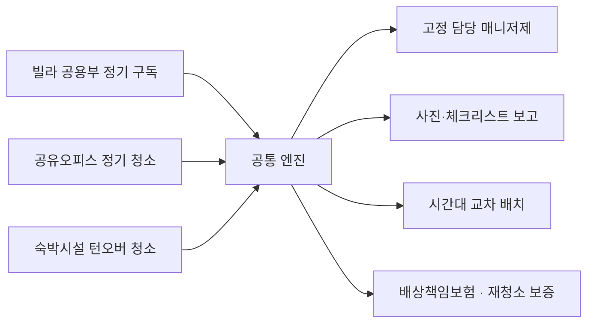

# 01. 사업 요약 (Executive Summary)

> [!NOTE]
> 이 문서와 02~08은 **목표 규모(스케일업) 시나리오**입니다. 실제 시작 조건(자본금 300만 원·1인·주말 빌라 청소)은 [09 린 스타트 계획](09_lean_start_plan.md)을 따르세요.

## 1. 한 줄 정의

> **"대치동에서 시작해 강남 전역의 건물·공간을 구독형으로 관리하는, 증빙 가능한 프리미엄 청소 서비스."**

사진·체크리스트·시간 기록으로 *청소가 이뤄졌음을 증명*하고, 같은 인력을 시간대별로 돌려 쓰는 **동선 밀집형 B2B2C 청소 사업**입니다.

---

## 2. 문제 — 고객이 겪는 불편

| 고객 | 현재 문제 |
|------|----------|
| **소형 빌라 임대인·관리단** | 관리인이 없어 계단·복도·분리수거장이 방치됨 → 민원·공실·건물 가치 하락. 개인 아주머니 고용은 대체 인력·품질 통제가 어렵고, 대형 용역업체는 소형 건물을 외면하거나 단가가 맞지 않음 |
| **공유오피스 운영사(중소형)** | 대형 브랜드처럼 전담팀을 두기 어렵고, 외주 업체의 품질이 들쭉날쭉. 입주사 불만은 곧 해지 |
| **숙박시설 호스트** | 체크아웃~체크인 사이 **4시간 안에** 청소·린넨·보충이 끝나야 함. 청결 점수가 곧 매출. 매번 청소자를 구하고 사진 확인하는 것이 일상 |

**공통 병목은 "믿을 만한 인력의 정기 공급 + 확인 가능한 품질"** 입니다.

---

## 3. 해결 — 서비스 3종 + 공통 엔진

| 세그먼트 | 계약 형태 | 월 단가(가정) | 총마진(가정) | 역할 |
|----------|-----------|--------------|-------------|------|
| 빌라 공용부 | 월 구독 | 22만~55만 | 45% | **안정성의 닻** (낮은 이탈) |
| 공유오피스 | 월 계약 | 100만~270만 | 40% | **마진 + 신뢰 레퍼런스** |
| 숙박 턴오버 | 건당/월 정산 | 객실당 약 63만 | 39% | **매출 엔진** (물량 큼, 이탈도 큼) |

---

## 4. 핵심 통찰 6가지

1. **수익을 가르는 것은 수요가 아니라 "동선 밀도"다.**
   인건비의 상당 부분이 이동·대기 시간에서 샌다. 반경 2km 안에 고객을 촘촘히 모으면 가동률이 올라가 마진이 생긴다. 대치동은 이 밀집 전략을 쓰기에 이상적인 교두보다.

2. **세 세그먼트는 시간대가 서로 맞물린다.**
   오피스(출근 전 06~09시) → 빌라(09:30~12시) → 숙박(11~16시). **같은 사람이 하루 6시간 연속**으로 일하며 공백이 거의 없다. 단일 세그먼트 업체는 만들 수 없는 가동률이다.

3. **포트폴리오로 리스크를 상쇄한다.**
   숙박은 규제·계절성에 흔들리고, 빌라는 단가가 낮지만 이탈이 거의 없고, 오피스는 영업 주기가 길다. 어느 한쪽이 흔들려도 전체가 버틴다.

4. **대치동의 본질은 '신뢰가 곧 가격'이다.**
   고소득·품질 민감·입소문 강한 동네. 가격 경쟁이 아니라 **증빙(사진·로그·보험)과 고정 담당자**로 프리미엄을 정당화한다.

5. **청소는 사실상 '인력 운영 사업'이다.**
   채용·교육·스케줄·이탈 방지가 경쟁우위다. 초기엔 노션/시트 기반, 규모가 커지면 자체 운영툴로 간다.

6. **숙박은 "합법 숙소 우선" 정책으로 간다.**
   강남 숙박 상당수가 미등록·오피스텔 기반이라 단속 리스크가 크다. 온보딩에서 합법 여부를 확인하고, 합법 숙소(도시민박업·숙박업 등록 시설·소형호텔/레지던스·30일 이상 장기 체류)를 우선한다. 매출은 줄 수 있어도 사업 생존력이 올라간다. *(법령은 변경될 수 있어 [확인필요])*

---

## 5. 왜 대치동인가

| 요소 | 대치동의 강점 | 주의점 |
|------|--------------|--------|
| 주거 | **대치4동**(선릉·한티역 배후) 중심으로 저층 다세대·빌라 밀집 [사실: 서울시·강남구 자료] | 대치1·2동은 대단지 아파트가 많아 빌라 밀도 낮음 |
| 상권 | 학원가 이면 중소형 건물, 공유오피스·스터디카페 분포 | 대형 빌딩은 기존 용역사와 계약 |
| 인접 | 선릉·삼성·역삼(테헤란로 공유오피스 밀집), 코엑스 | 숙박 밀도는 인접 동이 더 높음 → **반경 2km로 정의** |
| 수요 특성 | **방학 시즌 지방·해외 학생·학부모 단기 체류** 수요 → 입퇴실 클리닝 | 시즌 편중 |
| 고객 성향 | 품질 민감·높은 지불의사·강한 입소문 | 한 번의 사고가 평판을 흔듦 |

---

## 6. 3개년 재무 스냅샷 (기본 시나리오, 대표 급여 포함)

| 구분 | Y1 (2027) | Y2 (2028) | Y3 (2029) |
|------|-----------|-----------|-----------|
| 연 매출 | **1.32억** | **5.06억** | **10.97억** |
| 공헌이익(변동비 차감) | 5,030만 (38%) | 2.03억 (40%) | 4.61억 (42%) |
| 고정비 | 9,660만 | 1.65억 | 3.72억 |
| **영업이익** | **−4,630만** | **+3,760만** | **+8,890만** |
| 월 기준 고객(말 기준) | 빌라 20·오피스 3·객실 20 | 50·8·60 | 90·15·120 |
| 청소 인력(말 기준) | 약 7명 | 약 19명 | 약 38명 |

- **손익분기: 약 15개월차, 월 매출 약 3,000만 원 수준** [가정]
- **필요 자금: 약 1억 원** (초기 투자 2,500만 + 초기 적자 4,630만 + 운전자금 1,500만 + 예비비)
- 보수 시나리오(60% 달성)에서도 Y2 영업손실은 약 −1,000만으로 **치명적이지 않도록** 고정비를 매출에 연동해 증설 ([06 문서](06_financial_plan.md) 참조)

> [!NOTE]
> Y1 적자는 대표·현장반장 급여를 모두 비용으로 잡은 보수적 설계입니다. 대표가 현장에 직접 투입되면 필요 자금은 크게 줄어듭니다.

---

## 7. 성공을 좌우하는 4가지

1. **첫 90일 안에 대치동 "레퍼런스 10동"** 확보 (비포/애프터와 후기)
2. **채용·이탈 관리** — 월 이탈률 5% 미만의 현장 인력 풀
3. **현금흐름** — 숙박은 선충전/카드 즉시결제, B2B는 월말 정산 + 30일 이내 회수
4. **합법·보험 방어막** — 배상책임보험, 산재, 합법 숙소 정책

## 8. 가장 큰 리스크 3가지

| 리스크 | 대응 |
|--------|------|
| 현장 인력 확보·이탈 | 6시간 연속 근무 설계, 고정 담당제, 성과 인센티브, 대기 인력 풀 |
| 숙박 규제·단속으로 인한 매출 집중 위험 | 합법 숙소 우선, 숙박 매출 비중 65% 이내 관리 |
| 초기 현금 소진 | 게이트 지표 미달 시 증설 중단, 고정비 변동화 |

---

## 9. 다음 행동

1. **Phase 0 (D-60~D0) 현장 실사 2주**: 건축물대장·강남구 인허가 데이터로 대치동 타깃 리스트 구축
2. 시범 계약 10건 확보 후 가격표 확정
3. 사업자 등록·보험·차량·소프트웨어 세팅

자세한 일정은 [08. 로드맵](08_roadmap_kpi.md) 참조.
