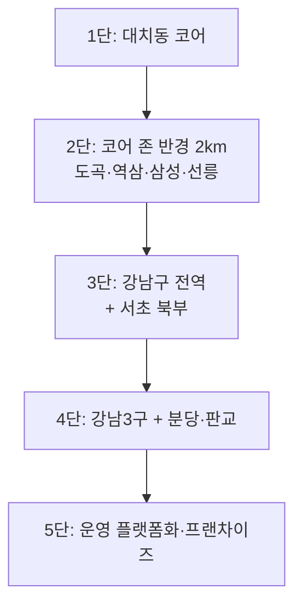
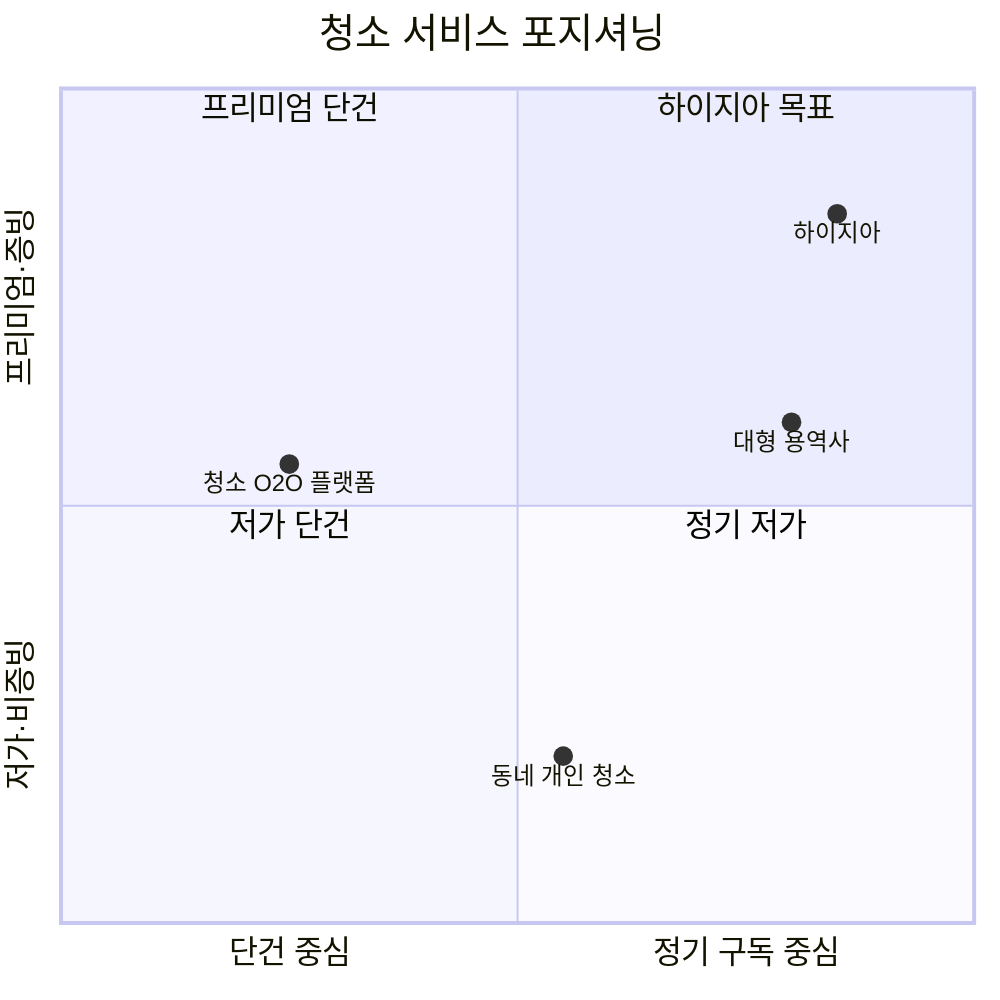

# 02. 시장 분석

> 표기: **[사실]** 확인된 사실 / **[가정]** 검증 전 추정 / **[확인필요]** 전문가·관청 확인 필요

---

## 1. 지리적 정의 — "코어 존"

대치동만으로는 세 세그먼트를 모두 채울 밀도가 나오지 않습니다. 그래서 **차량 이동 15분 이내 / 반경 약 2km**를 코어 존으로 정의합니다.

| 지역 | 빌라 | 공유오피스 | 숙박 | 비고 |
|------|:----:|:---------:|:----:|------|
| 대치4동 (선릉·한티 배후) | ★★★ | ★★ | ★ | **빌라 밀집 1순위** |
| 대치1·2동 | ★ | ★ | ★ | 대단지 아파트 중심 → 학원가 소형 건물만 |
| 역삼·선릉 | ★★ | ★★★ | ★★★ | 오피스·숙박 핵심 |
| 삼성·봉은사 | ★ | ★★★ | ★★★ | 코엑스 인접, 사옥형 오피스 |
| 도곡·개포 | ★★ | ★ | ★ | 중소형 빌라 |

---

## 2. 대치동 입지 특성

- **주거**: 대치동은 은마·래미안대치팰리스·한보미도맨션 등 **대단지 아파트가 주택 재고의 대부분(약 70~80% 이상)** [사실, 서울시·강남구 자료 기반]. 반면 **대치4동**은 과거 저층 주거지(구마을) 성격으로 다세대·다가구·연립이 가장 밀집 [사실].
- **빌라 규모**: 4세대~12세대, 4층 이하 소형 건물이 다수 [사실 경향]. 관리인 상주 건물은 드물어 **"공용부 방치" 페인포인트**가 구조적으로 존재 [가정].
- **학원가**: 학원·스터디카페 이면의 소형 건물은 **야간·주말 영업**이 많아 청소 시간대 협의가 필요하지만, 정기 수요가 꾸준함 → 4번째 세그먼트(확장 옵션).
- **방학 시즌**: 겨울(12~2월)·여름(7~8월) 방학 특강 기간 지방·해외 가족의 **한 달 안팎 단기 체류** 수요 [가정]. 입퇴실 클리닝이 별도 상품이 됨.
- **인접 업무지구**: 선릉·역삼·삼성(테헤란로)은 **강남구 내 100개 이상 공유오피스 지점**이 밀집 [사실]. 대치동 자체는 테헤란로 동측 끝과 학원가 이면의 중소형 빌딩 중심 [사실].

---

## 3. 세그먼트별 분석

### 3.1 빌라 공용부 정기 청소

| 항목 | 내용 |
|------|------|
| 의사결정자 | 임대인(건물주), 관리단 대표, 관리 위탁을 맡은 부동산 |
| 구매 동기 | 민원·공실 방지, 건물 이미지, 본인 시간 절약 |
| 지불 구조 | 임대인 단독 부담 또는 세대별 관리비 분담 (세대당 월 2~3만 원) |
| 경쟁 | 동네 개인 아주머니, 건물관리 소업체, 가사도우미 플랫폼(이사·입주청소 중심) |
| 우리 차별화 | 사진 보고·고정 담당·대체 인력 보장·보험 |
| 이탈 | **낮음** (품질 사고만 없으면 장기 유지) |
| 영업 주기 | 짧음 (1~3주) |

### 3.2 공유오피스 정기 청소

| 항목 | 내용 |
|------|------|
| 의사결정자 | 지점 매니저·운영 총괄·시설 담당 |
| 구매 동기 | 입주사 만족, 해지 방지, 시설 이미지 |
| 시장 구조 | **대형 브랜드(패스트파이브·스파크플러스·위워크 등)는 본사 단위 용역 계약** → 신규 진입 어려움. **중소·독립 지점과 서브리스 운영사가 타깃** |
| 트렌드 | 사옥형 커스텀 오피스 증가, 월 단위 계약, 강남 GBD 공실률 낮고 임대료 상승 [사실 경향] |
| 우리 차별화 | 출근 전 06~09시 완료, 보안 서약·출입 로그, 입주사 클레임 대응 SLA |
| 영업 주기 | 길다 (1~3개월), 시범 청소 1회가 결정적 |

### 3.3 숙박시설 턴오버 청소

| 항목 | 내용 |
|------|------|
| 의사결정자 | 호스트(개인), 소규모 운영사, 레지던스·게스트하우스 |
| 구매 동기 | **청결 점수 = 매출**, 시간 절약, 린넨·보충 자동화 |
| 수요 특성 | 체크아웃 11시 → 체크인 15시, 4시간 윈도우에 집중 |
| 변동성 | 높음 (성수기 봄·가을, 방학 시즌 편중) [가정] |
| 규제 | **외국인관광 도시민박업은 거주 주택 대상, 오피스텔 제외** [사실]. 미등록·샌드박스 운영 숙소 다수 [사실 경향] → [확인필요] |
| 우리 차별화 | 캘린더(iCal) 연동 자동 배차, 사진 보고, 청결 점수 방어, 린넨·어메니티 통합 |
| 이탈 | **높음** (월 5~8% 가정) |

> [!WARNING]
> 강남의 에어비앤비는 **합법성이 불균질**합니다. 계약 전 한국관광공사 세이프스테이(Safe Stay) 합법 숙소 조회와 강남구 관광진흥과 사전정보공표(외국인관광 도시민박업 등록 현황)로 확인하는 절차를 온보딩에 넣어야 합니다.

---

## 4. 시장 규모 추정 (페르미 추정 — 전부 [가정])

> 정확한 값은 Phase 0에서 **건축물대장 개방 API + 강남구 인허가 데이터 + 숙박 데이터 서비스**로 교체합니다.

### 4.1 코어 존(반경 2km) SAM

| 세그먼트 | 모수 추정 | 접근 가능 비율 | 월 단가 | **연 SAM** |
|----------|-----------|----------------|---------|-----------|
| 빌라 | 소형 공동주택 1,500~2,500동 | 관리인 없음 60% × 외주 의향 40% ≈ 24% → **360~600동** | 25만 | **약 10.8~18억** |
| 숙박 | 단기숙박 객실 1,500~3,000실 | 외주 청소 이용·합법 우선 50% → **750~1,500실** | 63만 | **약 57~113억** |
| 공유오피스 | 80~120개 지점 | 중소·독립 40% → **32~48곳** | 150만 | **약 5.8~8.6억** |
| **합계** | | | | **약 73~140억/년** |

### 4.2 우리의 목표 점유(SOM)

| 시점 | 지리 범위 | 매출 | SAM 대비 |
|------|-----------|------|----------|
| Y1 | 대치 + 코어 존 일부 | 1.32억 | 약 1~2% |
| Y2 | 코어 존 | 5.06억 | 약 4~7% |
| Y3 | 강남구 전역 확장(SAM 약 2배, 146~280억) | 10.97억 | 약 4~8% |

→ **점유율 목표 자체는 크지 않습니다.** 병목은 시장이 아니라 **"인력 채용과 품질 통제 속도"** 입니다.

---

## 5. 경쟁 환경

| 유형 | 예시 | 강점 | 약점 (우리의 기회) |
|------|------|------|--------------------|
| 대형 건물관리·용역사 | 대형 시설관리 업체 | 신뢰·규모 | 소형 건물 외면, 단가 높음, 소규모 정기 계약에 비효율 |
| 청소 O2O/가사 플랫폼 | 청소연구소, 미소 등 | 브랜드·예약 UX | **이사·입주청소 단건 중심**, 정기 B2B·숙박 턴오버 약함, 지역 밀도 낮음 |
| 숙박 운영 대행사 | 숙소 관리 대행 업체 | 호스트 접점 | 청소 품질 편차, 청소는 외주 |
| 동네 개인 청소 | 아주머니·용역 | 저렴, 유연 | 대체 인력·보험·증빙 없음 |

**포지셔닝 맵 (단순화)**

---

## 6. 고객 페르소나

| 페르소나 | 프로필 | 핵심 니즈 | 결정 포인트 |
|----------|--------|-----------|-------------|
| **박 사장** | 58세, 대치동 다세대 건물주(8세대), 월세 수입 | 민원 없는 건물, 귀찮음 최소화 | 믿을 만한 사람, 사진 보고, 가격 |
| **김 호스트** | 38세 직장인, 역삼 인근 2객실 운영 | 청결 점수 4.8 이상, 시간 절약 | 시간 약속, 린넨 처리, 캘린더 자동화 |
| **이 지점장** | 선릉 중소형 공유오피스 매니저 | 입주사 클레임 제로, 아침 출근 전 완료 | 시범 청소 결과, 보안, SLA |
| **한 대표** | 대치 학원가 소형 학원·스터디카페 운영 | 야간 후 청소, 위생 | 시간대 협의, 정기 계약 |

---

## 7. 외부 환경 (PEST 요약)

| 요소 | 내용 | 영향 |
|------|------|------|
| 정치·법 | 숙박 규제 변동 가능성 [확인필요], 5인 이상 근로기준법 전면 적용, 중대재해처벌법 | 숙박 매출 변동 리스크, 노무 비용 |
| 경제 | **최저임금 2027년 10,700원(+3.7%)** [사실], 인건비 지속 상승 | **연 1회 단가 인상 조항 필수** |
| 사회 | 고령 임대인 증가, 맞벌이·1인 가구, 외국인 관광객 회복 | 아웃소싱 수요 구조적 증가 |
| 기술 | 스마트도어락, 캘린더 연동, 사진 보고 앱 | 운영툴이 차별화·진입장벽 |

---

## 8. 검증해야 할 시장 가정 (Phase 0 체크리스트)

- [ ] 대치동·도곡·역삼·삼성 반경 2km 내 소형 공동주택 동수(건축물대장 기반)
- [ ] 강남구 외국인관광 도시민박업 등록 숙소 수·분포 (사전정보공표 엑셀)
- [ ] 에어비앤비 실제 리스팅 수·가동률·평균 숙박일수 (데이터 서비스 또는 수작업 샘플링)
- [ ] 코어 존 중소·독립 공유오피스 지점 리스트 및 현 청소 계약 여부
- [ ] 빌라 20곳 방문 인터뷰: 현재 청소 방식·비용·불만
- [ ] 숙박 호스트 10명 인터뷰: 현재 청소 단가·시간·사고 경험
- [ ] 경쟁사 5곳 가격 미스터리 쇼핑
