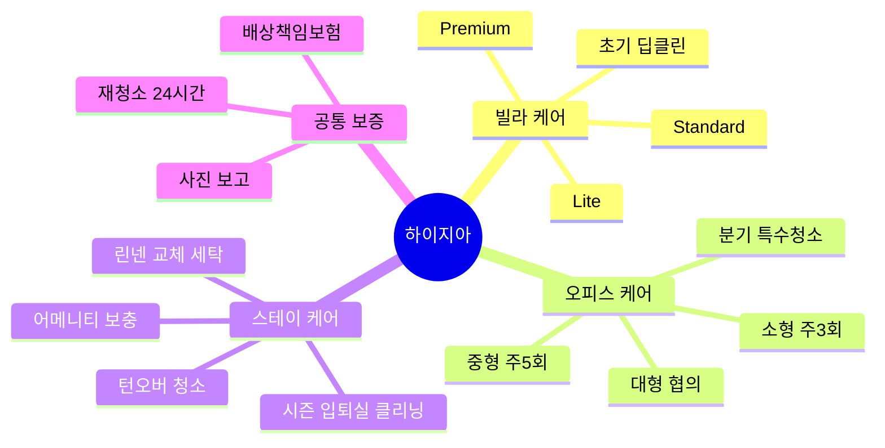

# 03. 서비스 구성 및 가격

> 가격은 **[가정]** — Phase 0 가격 미스터리 쇼핑과 시범 계약 10건으로 확정합니다.
> 인건비 기준: 2027년 최저임금 10,700원 [사실]. 청소 매니저 시급 13,000원, 주휴·4대보험·퇴직충당 포함 **실부담 약 17,000원/인시** [가정].

---

## 1. 서비스 카탈로그

---

## 2. 빌라 케어 (월 구독)

대상: 관리인이 없는 4~16세대 소형 공동주택의 **계단·복도·현관·엘리베이터·분리수거장**.

| 플랜 | 대상 | 방문 | 포함 | **월 가격** |
|------|------|------|------|------------|
| **Lite** | 3층 이하, 8세대 이하 | 주 1회 | 계단·복도 쓸고 닦기, 현관·우편함, 쓰레기 정리 | **22만 원** |
| **Standard** | 4~5층, 9~16세대 | 주 2회 | Lite + 분리수거장 정리, 난간·손잡이 소독, 거미줄·먼지 | **38만 원** |
| **Premium** | 엘리베이터·지하 주차장 포함 | 주 3회 | Standard + 엘리베이터 내부, 주차장 바닥, 분기 유리창 1회 | **55만 원** |

**부가 상품**
| 상품 | 가격 | 설명 |
|------|------|------|
| **초기 딥클린** (신규 계약 시 1회) | 30~60만 원 | 묵은 때·곰팡이 제거. 선결제 현금 확보 + 시작 품질 기준선 확립 |
| 분기 유리창·방충망 | 15만 원/회 | 외부 접근은 안전장비 필수 → 고층·외벽은 제휴 업체 |
| 방역·소독 연계 | 제휴가 | 해충 방제 업체 연계 수수료 |
| 겨울 제설·결빙 관리 | 협의 | 12~2월 단기 옵션 |

> **세대 분담 모델**: 임대인이 부담하기 어려운 건물을 위해 "세대당 월 2.5만 원 청구서" 템플릿을 제공해 관리단 합의를 쉽게 만든다.

---

## 3. 오피스 케어 (월 계약)

대상: 중소·독립 공유오피스, 소형 사옥형 사무실, 학원·스터디카페.

| 플랜 | 규모(가정) | 방문 | 작업 시간 | **월 가격** |
|------|-----------|------|-----------|------------|
| **소형** | 30~50평 | 주 3회 | 1인 2.5시간 | **100만 원** |
| **중형** | 50~100평 | 주 5회 | 2인 2시간 | **270만 원** |
| **대형/멀티 지점** | 100평 이상 | 협의 | 협의 | 평당 2.4~2.8만 원 수준 협상 |

**포함**: 바닥 청소·쓰레기 수거(분리배출), 화장실·탕비실, 회의실 정리, 데스크 외부 소독(개인 서류 이동 금지).
**옵션**: 분기 카펫 스팀(층당 80~150만), 유리·파티션, 탕비 소모품 보충(실비+10%), 소독 방역.

**진입 전략**: 계약 전 **시범 청소 1회 무료** + 사진·체크리스트 공유 → 지점장이 결정할 근거를 제공.

---

## 4. 스테이 케어 (숙박시설)

### 4.1 턴오버 청소 (건당)

| 규모 | 면적 | **건당 가격** | 소요(가정) |
|------|------|--------------|-----------|
| 스튜디오·원룸 | ~25㎡ | **55,000원** | 1.5~2인시 |
| 투룸 | ~45㎡ | **80,000원** | 2.5인시 |
| 쓰리룸 | ~70㎡ | **110,000원** | 3.5~4인시 |
| 대형 | 70㎡+ | ㎡당 협의 | |

**추가 상품**
| 상품 | 가격 |
|------|------|
| 침구 1세트 교체·세탁 | 12,000원 |
| 수건 4매 교체·세탁 | 4,000원 |
| 어메니티 보충 | 실비 + 10% |
| 긴급 당일(2시간 내 배차) | +30% |
| 분기 딥클린 | 객실당 15~25만 원 |
| 체크인 전 점검(고장·분실물·파손 사진 보고) | 건당 5,000원 (월정액 시 무료) |

평균 객단가 **약 9만 원/턴**(청소 7.5만 + 린넨 1.5만) [가정]. 객실당 월 7회 → **월 약 63만 원**.

### 4.2 호스트 플랜 (구독)

| 플랜 | 조건 | 혜택 |
|------|------|------|
| **Pay-per-turn** | 제한 없음 | 건당 결제 |
| **Host Care** | 월 5회 이상 확약 | 5% 할인, 고정 담당, 우선 배차 |
| **Host Pro** | 5객실 이상 | 8~10% 할인, 린넨 풀링, 월간 청결·재고 리포트 |

### 4.3 시즌 입퇴실 클리닝 (대치동 특화)

방학 시즌 한 달 안팎 단기 체류(월세 계약) 숙소의 **입실 전·퇴실 후 클리닝**:
- 투룸 기준 **12~18만 원** (딥 포함), 학원가 부동산·임대인 제휴
- 30일 이상 임대차는 숙박업 규제와 별개로 운영 가능 [확인필요]

### 4.4 합법 숙소 온보딩 체크리스트 (필수)
- [ ] 도시민박업 등록증·숙박업 등록증 사본, 또는 30일 이상 장기 임대 계약 구조 확인
- [ ] 세이프스테이 합법 숙소 조회 결과 캡처
- [ ] 건축물 용도(오피스텔 여부) 확인
- [ ] 위 항목 미충족 시 → 계약 보류 또는 **"장기 체류 입퇴실 상품"으로만** 제한

---

## 5. 공통 보증 · 차별화 장치

| 장치 | 내용 | 효과 |
|------|------|------|
| **24시간 재청소 보증** | 불만 접수 시 24시간 내 무상 재청소 | 신뢰·해지 방어 |
| **사진·체크리스트 보고** | 작업 전/후 사진, 타임스탬프, 체크 항목 | 증빙·분쟁 방어 |
| **고정 담당 매니저제** | 빌라·오피스는 2인 고정 팀 | 고객 신뢰·이탈 방지 |
| **대체 인력 보장** | 결근 시 2시간 내 대체 | 서비스 연속성 |
| **배상책임보험** | 파손·사고 보상 | 고객 불안 해소 |
| **청결 점수 보장(숙박)** | 청소 사유 낮은 평점 시 크레딧 | 호스트에게 가장 강한 약속 |
| **연 1회 단가 조정 조항** | 최저임금 인상률 연동 | 마진 보호 |

---

## 6. 단가 대비 인시당 매출 (수익성 점검)

| 세그먼트 | 월 매출 | 월 인시(가정) | **인시당 매출** | 실부담 인건비 17,000원 대비 |
|----------|---------|--------------|----------------|--------------------------|
| 빌라 Lite | 22만 | 6 | 36,700원 | 인건비율 46% |
| 오피스 소형 | 100만 | 32.5 | 30,800원 | 55% |
| 오피스 중형 | 270만 | 88 | 30,700원 | 55% |
| 숙박 투룸 턴오버(9만) | 9만/건 | 2.5/건 | 36,000원 | 47% |

> **관리 목표**: 인시당 매출 **≥ 33,000원**, 이동시간 비율 **≤ 12%**.
> 이를 밑돌면 가격 인상 또는 동선 재편 대상.

---

## 7. 가격 정책 원칙

1. **싼 가격으로 이기지 않는다.** 대치동은 '신뢰'가 가격을 만든다. 시장 평균 대비 **+10~20% 프리미엄**을 증빙으로 정당화.
2. **첫 계약은 낮은 문턱**(시범 1회 무료·첫 달 50% 등), **재계약은 정가**.
3. **연 1회 자동 인상 조항**(최저임금 인상률+α) 계약서에 명시.
4. **번들 할인**: 같은 고객(예: 임대인이 빌라와 숙소를 함께 보유)에게 복수 서비스 시 5% 할인 → 동선·영업비 절감.
