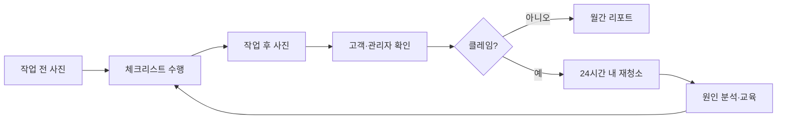

# 04. 운영 · 품질 계획

> 청소 사업의 경쟁력은 **"인력 운영 시스템"** 에서 나옵니다. 이 문서는 하루 일과, 인력, 품질, 도구, 보안·안전을 정의합니다.

---

## 1. 운영 원칙

1. **동선 밀도 우선** — 신규 계약은 기존 동선과 가까운 곳부터 (반경 2km, 이동 15분 내)
2. **하루 6시간 연속** — 이동·대기 낭비 제거, 매니저 만족과 이탈률 개선
3. **고정 담당제** — 빌라·오피스는 같은 2인이 계속 방문
4. **증빙이 기본값** — 모든 작업은 사진·체크리스트로 남는다
5. **표준화 후 확장** — SOP가 없는 지점은 열지 않는다

---

## 2. 시간대 교차 배치 (핵심 설계)

```mermaid
gantt
    title 하루 운영 패턴 (A조·B조)
    dateFormat HH:mm
    axisFormat %H:%M
    section A조
    공유오피스 (출근 전)    :a1, 06:00, 3h
    이동·휴식               :a2, 09:00, 30m
    빌라 공용부             :a3, 09:30, 2h30m
    section B조
    에어비앤비 턴오버 1차   :b1, 10:30, 4h30m
    에어비앤비 턴오버 2차   :b2, 15:00, 1h30m
    section 예비/지원
    오피스 저녁·특수청소    :c1, 19:00, 3h
```

| 조 | 시간 | 주 업무 | 특징 |
|----|------|---------|------|
| A조 | 06:00~12:00 | 오피스 → 빌라 | 야간 가산(22~06시) 회피, 소음 민원 없는 시간 |
| B조 | 10:30~16:30 | 숙박 턴오버 | 체크아웃~체크인 윈도우 정확히 겨냥 |
| 지원 | 필요 시 | 오피스 저녁, 딥클린, 대체 인력 | 파트타임·대기 인력 |

- 6시 시작은 지원자 모집이 어렵다 → **A조는 시급 +500원 새벽 수당** 설계.
- 5인 이상 사업장에서는 22~06시 야간·연장 가산이 발생하므로 **06시 이후 시작**으로 설계 [확인필요].

---

## 3. 인력 계획

### 3.1 소요 인력 추정

| 시점 | 월 총 인시 | 매니저(가동률 75% 가정) | 비고 |
|------|-----------|--------------------------|------|
| Y1 말 | 약 650 | **약 7명** (정규 2 + 파트 5) | 현장반장 1 |
| Y2 말 | 약 1,800 | **약 19명** | 현장총괄 + 반장 |
| Y3 말 | 약 3,400 | **약 38명** | 지점·조 단위 운영 |

> 월 130시간(주 30시간)이 1인 기준. 5인 이상부터 근로기준법 전면 적용, 5~49인은 중대재해처벌법 적용 → [07 문서](07_legal_risk.md).

### 3.2 채용 경로
- 지역 일자리센터·**서울시 신중년/시니어 일자리 연계**, 경력단절 여성 커뮤니티
- 알바 플랫폼(알바천국/알바몬/당근알바)에서 **"주 30시간 고정 시급 + 인센티브"** 로 차별화
- **추천 보너스**: 신규 매니저 추천 시 추천자·신규자 각 20만 원 (3개월 근속 후 지급)
- 외국인 채용은 체류자격(취업 가능 여부) 확인 필수 [확인필요]

### 3.3 보상 구조 (예시)

| 항목 | 내용 |
|------|------|
| 기본 시급 | 13,000원 (2027 최저 10,700원 대비 +21%, 강남 프리미엄) |
| 새벽 수당 | 06~08시 시작 시 +500원 |
| 품질 인센티브 | 월 재청소율 2% 이하·고객 평점 4.8 이상 시 월 10만 원 |
| 장기 근속 | 6개월 +300원, 12개월 +500원 |
| 지원 | 유니폼·장비·교통카드·건강검진 일부 |

### 3.4 교육 (온보딩 3일)
1. **Day 1**: 위생·약품 안전, 장비 사용, 체크리스트 이해
2. **Day 2**: 실습(선임과 동행), 사진 촬영 기준
3. **Day 3**: 보안·고객 응대·분실/파손 대응, 소규모 단독 실습
4. 월 1회 정기 품질 교육, 분기 품질 인증 시험

---

## 4. 품질 관리

### 4.1 품질 루프

### 4.2 체크리스트 구조 (예: 빌라 계단)
| 영역 | 점검 항목 | 사진 |
|------|----------|------|
| 현관 | 출입문 유리, 우편함, 신발장 | 전/후 |
| 계단 | 층별 바닥, 난간, 모서리 먼지 | 층별 1컷 |
| 복도 | 센서등 먼지, 창문턱 | 층별 |
| 분리수거장 | 정리·악취 | 전/후 |
| 기타 | 거미줄, 음식물 얼룩 | 필요 시 |

### 4.3 품질 지표
| 지표 | 목표 |
|------|------|
| 재청소율 | **≤ 3%** (경고 5%) |
| 고객 만족(NPS 또는 평점) | NPS ≥ 50 / 평점 4.8+ |
| 시간 준수율 | ≥ 98% |
| 사진 보고 제출률 | **100%** |
| 매니저 월 이탈률 | **≤ 5%** |

### 4.4 현장 감사
- 반장이 **주 1회 무작위 점검**, 신규 고객 첫 4주는 매 방문 확인
- 월 1회 **미스터리 점검**(고객 입장 확인)

---

## 5. 운영 도구

### 5.1 단계별 스택

| 단계 | 도구 | 비고 |
|------|------|------|
| **Phase 1 (노코드)** | 구글 시트/노션 + 카카오톡 채널·알림톡, 구글 폼 체크리스트, 구글 캘린더 | 비용 월 20만 원 이내 |
| **Phase 2 (반자동)** | iCal 연동 배차 스크립트, 사진 보고용 폼 + 자동 PDF 리포트, 전자계약 | 호스트 캘린더 자동 감지 |
| **Phase 3 (자체 앱)** | 매니저 앱(배차·체크리스트·사진), 고객 포털, 정산 | 본 저장소를 개발 거점으로 활용 가능 |

### 5.2 숙박 배차 로직 (핵심 자동화)
1. 호스트가 에어비앤비 캘린더 **iCal 링크** 등록
2. 체크아웃 예정일이 감지되면 **자동 작업 생성**
3. 가용 매니저·동선 기준 **자동 배정**
4. 작업 완료 시 사진·린넨 상태·재고 알림을 **호스트에게 카톡 발송**

---

## 6. 보안 · 열쇠 관리 (고객 신뢰의 핵심)

| 항목 | 원칙 |
|------|------|
| 도어락 | 스마트도어락 **일회용·기간제 코드** 사용, 번호 평문 공유 금지 |
| 열쇠 | 키박스/전자키 로그 기록, 분실 시 24시간 내 교체 비용 보상 |
| 오피스 | 보안서약서, 서류·모니터 촬영 금지, 출입 로그 |
| 사진 | 개인 소지품·얼굴·서류는 촬영 금지 가이드 |
| 개인정보 | 도어락 번호·고객 정보 암호화 저장, 접근 권한 최소화 [개인정보보호법] |

---

## 7. 안전 · 보건

- 약품: 혼용 금지 교육, **MSDS** 비치, 보호구(장갑·마스크·보안경)
- 근골격계: 장비(무릎보호대·긴 손잡이 청소도구), 중량 제한
- **고소 작업(외벽·고층 유리)은 직접 수행하지 않고 제휴 업체** 활용
- 바닥 미끄러짐 방지 표지, 계단 작업 시 2인 1조
- 사고 발생 시: 산재 신고 절차 → [07 문서](07_legal_risk.md)

---

## 8. 자재 · 린넨 · 장비

| 항목 | 방식 |
|------|------|
| 청소 자재 | 업소용 대량 구매(온라인 도매), 성분·냄새 표준화, 안전한 약품 |
| 린넨 | **신고된 상업세탁소 외주**(자체 세탁은 세탁업 신고 이슈 → [확인필요]), 호스트 린넨 vs 하이지아 풀링 린넨 선택 |
| 장비 | 업소용 청소기·스팀 청소기·마이크로화이버 표준 세트, 카트 |
| 보관 | 소형 창고/공유 창고(월 50~100만 원) 대치동 인접 |
| 차량 | 중고 리스 승합/경형 밴 1대(Y1) → 3대(Y2) |

---

## 9. 계절성 · 수요 변동 대응

| 시기 | 예상 | 대응 |
|------|------|------|
| 1~2월 | 숙박 비수기 [가정], 대치동 겨울방학 특강 수요 | 빌라·오피스 안정화, 시즌 입퇴실 클리닝 |
| 3~5월 | 숙박 성수기 | 매니저 풀 사전 확대, 대기 인력 확보 |
| 7~8월 | 여름 휴가·방학 특강 | 시즌 입퇴실 + 숙박 |
| 9~11월 | 숙박 성수기 | 동선 재편 |
| 12월 | 연말 오피스 대청소 | 특수청소 상품 |

- 매니저 **정규 40% / 파트 60%** 로 변동 흡수
- 숙박 매출 비중이 **65%를 넘으면** 빌라·오피스 영업에 다시 투자 (구조적 방어)
