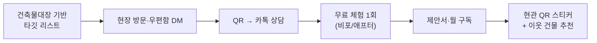

# 05. 마케팅 · 시장 진입(GTM) 전략

> 원칙: **대치동을 '섬'처럼 점령한 뒤 번져 나간다.** 좁은 곳에서 깊게, 그다음 넓게.

---

## 1. 브랜드 포지셔닝

| 항목 | 내용 |
|------|------|
| 브랜드 | **하이지아 (Hygeia)** — 위생의 여신 |
| 한 줄 약속 | **"청소했다는 것을, 보여드립니다."** |
| 핵심 가치 | 증빙(Proof) · 신뢰(Trust) · 정시(On-time) |
| 톤 | 차분·전문적·정직. 과장 없는 비포/애프터 |
| 시각 | 화이트 + 딥그린/세이지, 깨끗한 사진 중심 |
| 타깃 인식 | "동네 아주머니보다 믿을 만하고, 대형업체보다 빠르고 합리적" |

**브랜드 에셋**: 로고·유니폼(세이지 톤), 차량 래핑, 현관 QR 스티커(건물 청소 정보·민원 연락처), 명함, 소개서 PDF.

---

## 2. 세그먼트별 진입 전략

### 2.1 빌라 — "계단 한 동 무료 체험"

| 전술 | 내용 |
|------|------|
| **타깃 리스트** | 대치4동 우선, 4층 이하·4~16세대·준공 15년 이상(관리 부실 가능성 ↑) 건물을 건축물대장으로 선별 |
| **현장 방문** | 건물 앞 사진을 찍어 *"이 건물의 계단을 이렇게 바꿔드릴게요"* 와 함께 우편함 DM |
| **무료 체험 1회** | 단 한 개 층이라도 비포/애프터 → 그 자리에서 임대인/관리단에게 결과 전달 |
| **부동산 제휴** | 대치동 중개사무소 소개 수수료(첫 3개월 매출의 10%) 또는 공동 서비스 |
| **이웃 확산** | 한 건물 계약 → 인접 건물 3곳에 "이웃 건물에서 청소 중" DM (동선 밀집 효과) |
| **당근/네이버** | 당근 비즈프로필, 네이버 플레이스(후기), 지역 키워드 블로그 |

### 2.2 공유오피스 — "시범 청소 + 사진 보고서"

| 전술 | 내용 |
|------|------|
| **타깃** | 코어 존 중소·독립 지점, 서브리스 운영사, 소형 사옥형 오피스 (대형 브랜드는 3단계 이후) |
| **어프로치** | 콜드메일 + 방문 + 링크드인 → 지점장에게 **"시범 청소 1회 무료 + 보고서"** |
| **결정 근거** | 사진 보고서, 소요 시간, 보안 서약서, 보험 가입증, 1개월 SLA |
| **확장** | 한 운영사 안의 **다지점 계약**이 목표(1개 지점 성공 → 본사 소개) |
| **파트너** | 오피스 중개·임대 에이전시(공유오피스 중개 채널) |

### 2.3 숙박 — "호스트 커뮤니티 + 자동화로 락인"

| 전술 | 내용 |
|------|------|
| **호스트 커뮤니티** | 네이버 카페·오픈채팅·오프라인 모임에서 **"청소 사고 사례 + 체크리스트 무료 배포"** 콘텐츠 마케팅 |
| **첫 청소 50% 할인** | 첫 1건만 할인, 이후 정가. 사진 보고서로 신뢰 확보 |
| **공동 호스트 제휴** | 숙소 관리 대행 소규모 사업자, 인테리어/촬영 업체와 상호 소개 |
| **자동화로 락인** | iCal 연동 → 호스트가 청소 일정 신경 안 써도 되는 편의를 제공(전환 비용 상승) |
| **합법 숙소 우선** | "합법 숙소 전용 청소 파트너" 메시지 — 단속 걱정 없는 호스트에게 신뢰 포인트 |
| **방학 시즌 캠페인** | 학원가 부동산과 협업해 "방학 한 달 임대 퇴실 클리닝 패키지" |

---

## 3. 퍼널 목표 (Y1)

| 세그먼트 | 접촉 | 상담 | 시범/체험 | **계약** | 전환 가정 |
|----------|------|------|-----------|---------|-----------|
| 빌라 | DM·방문 5,000 | 75 (1.5%) | 40 | **20** | 시범→계약 50% |
| 오피스 | 아웃리치 100곳 | 25 | 12 | **3** | 시범→계약 25% |
| 숙박 | 커뮤니티 도달 3,000 | 80 | 40 | **20객실** | 시범→계약 50% |

> 위 전환율은 **[가정]**. 첫 90일 퍼널 측정 후 재설정한다.

---

## 4. 마케팅 예산 (Y1 약 2,400만 원)

| 항목 | 금액 | 비고 |
|------|------|------|
| 오프라인(DM·현수막·스티커) | 500만 | 5,000매 DM, QR 스티커 |
| 네이버 플레이스 광고·블로그·SEO | 600만 | 지역 키워드 |
| 당근·인스타·유튜브 숏폼 | 400만 | 비포/애프터 콘텐츠 |
| 시범·체험 제공 원가 | 500만 | 무료 시범 약 70건 |
| 브랜딩·촬영·소개서 | 400만 | 로고·사진·영상 |
| **합계** | **2,400만** | 월 약 200만 |

예산은 **CAC 상한**으로 관리: 빌라 30만 / 오피스 150만 / 호스트 20만 이하 [가정].

---

## 5. 90일 대치동 점령 전술 — "Daechi 10"

**목표: 대치동에서 레퍼런스 고객 10곳(빌라 6 + 숙박 3~4 + 오피스 시범 1~2)** 확보

| 기간 | 활동 |
|------|------|
| 1~4주 | 타깃 건물 300동 리스트업, 방문·DM 시작, 체험 신청 접수 |
| 5~8주 | 체험→계약 전환, 첫 계약 건물 비포/애프터 촬영, **후기 확보** |
| 9~12주 | 후기를 활용한 이웃 건물 DM 2차, 부동산 3곳 제휴, 호스트 모임 개최 |

**성과 지표**: 계약 10건, 재청소율 3% 이하, 후기 8건 이상, 첫 달 MRR ≥ 500만.

---

## 6. 고객 유지·확장

| 시점 | 활동 |
|------|------|
| 첫 방문 후 24시간 | 카톡으로 만족도 확인 |
| 월 1회 | 리포트(방문 횟수·이슈·개선 제안) |
| 분기 | 딥클린·유리 업셀 제안 |
| 6개월 | 다른 건물·다른 서비스 교차 제안(빌라 임대인 → 숙소 청소) |
| 해지 징후 | 재청소 2회 이상·결제 지연 → 반장 직접 방문 |

**추천 프로그램**: 소개한 고객·소개받은 고객 모두 1개월 10% 할인 or 현금 5만 원.

---

## 7. 메시지 카피 예시

- 빌라: *"입주민이 칭찬하는 계단 — 월 22만 원부터. 첫 체험은 무료."*
- 오피스: *"출근 전에 끝나는 청소. 사진으로 보고드립니다."*
- 숙박: *"체크아웃 후 4시간, 완벽하게 끝냅니다. 청결 점수 4.8 보장."*
- 공통: *"청소했다는 것을, 보여드립니다."*

---

## 8. 마케팅 KPI

| 지표 | 목표 |
|------|------|
| 월 신규 문의 | 빌라 15 / 오피스 4 / 숙박 15 (Y1 하반기) |
| 문의→계약 전환 | 빌라 25% / 오피스 15% / 숙박 25% |
| CAC 회수 기간 | **≤ 3개월** |
| 네이버 플레이스 후기 | Y1 말 50개, 평점 4.8+ |
| 추천 유입 비율 | Y2 30% 이상 |
