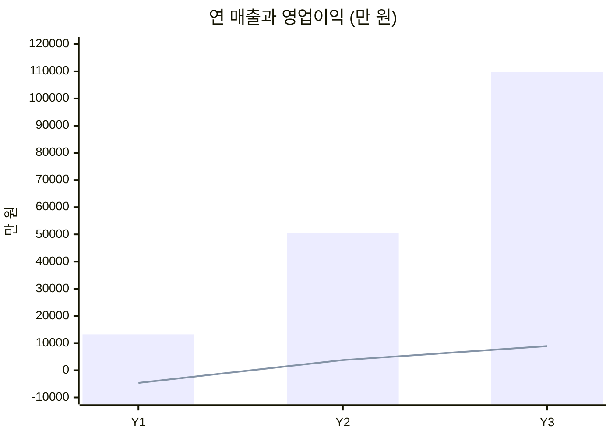
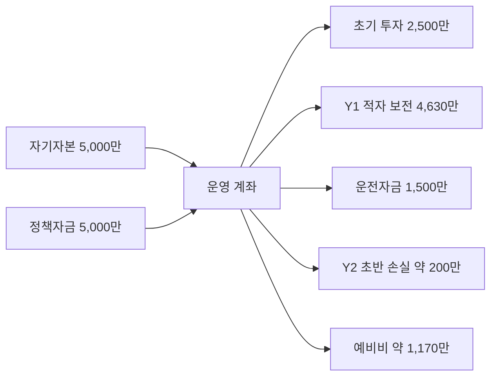

# 06. 재무 계획

> [!NOTE]
> 이 문서의 수치는 팀·차량·사무실을 갖춘 **스케일업 시나리오**(자금 약 1억 원) 기준입니다. 시작 단계(1인, 자본금 300만 원)의 손익은 [09 린 스타트 계획](09_lean_start_plan.md) 5절을 보세요.

> 모든 수치는 **[가정]** 이며 Phase 0 실사와 첫 90일 실적으로 교체합니다.
> 금액 단위: 원. "만" = 만 원, "억" = 억 원. 영업이익은 **대표 급여 포함**, 법인세·이자 제외.

---

## 1. 핵심 가정

| 항목 | 값 | 비고 |
|------|-----|------|
| 2027 최저임금 | 10,700원 | [사실] 고용노동부 |
| 매니저 기본 시급 | 13,000원 | 강남 프리미엄 포함 |
| 실부담 인건비 | **17,000원/인시** | 주휴·4대보험·퇴직충당 포함 |
| 빌라 ARPU | 월 25만 | Lite/Standard/Premium 믹스 |
| 오피스 ARPU | 월 150만 | 소형 70% : 중형 30% 믹스 (0.7×100 + 0.3×270 ≈ 151) |
| 숙박 객실당 월 매출 | 63만 | 월 7턴 × 9만 |
| 총마진(변동비 차감 후 공헌이익) | Y1 38% / Y2 40% / Y3 42% | 동선 밀도·구매력 개선 반영 |
| 대금 회수 | B2B 월말 정산 30일, 숙박 선충전/카드 즉시 | 미수금 관리 |

---

## 2. 단위 경제 (Unit Economics)

### 2.1 건당·월당 변동 손익

| 세그먼트 | 월 매출 | 월 인건비(인시×17,000) | 자재·이동·세탁 | **공헌이익** | **마진** |
|----------|---------|----------------------|----------------|------------|---------|
| 빌라 Lite | 22만 | 6h = 10.2만 | 약 1.5만 | ≈ 10.3만 | **47%** |
| 빌라 평균 | 25만 | — | — | ≈ 11.3만 | **45%** |
| 오피스 소형 | 100만 | 32.5h = 55.3만 | 약 5만 | ≈ 39.7만 | **40%** |
| 오피스 중형 | 270만 | 88h = 149.6만 | 약 12만 | ≈ 108.4만 | **40%** |
| 숙박 턴(평균 9만) | 9만 | 2.5h = 4.25만 | 린넨 0.8만 + 자재 0.3만 + 이동 0.15만 ≈ 1.25만 → 합 5.5만 | ≈ 3.5만 | **39%** |

### 2.2 고객 생애가치 (LTV) vs 획득비용 (CAC)

| 세그먼트 | ARPU | 마진 | 월 공헌 | 평균 유지(가정) | **LTV** | CAC | **LTV/CAC** |
|----------|------|------|---------|----------------|---------|-----|-------------|
| 빌라 | 25만 | 45% | 11.3만 | 18개월 | 약 203만 | 30만 | **6.8x** |
| 오피스 | 150만 | 40% | 60만 | 24개월 | 약 1,440만 | 150만 | **9.6x** |
| 숙박 호스트(1.5객실) | 94.5만 | 39% | 36.9만 | 12개월 | 약 443만 | 20만 | **22x** |

> 숙박은 LTV/CAC가 높지만 **이탈률(월 5~8%)과 규제 리스크** 때문에 신뢰도를 낮게 본다. 빌라·오피스가 안정성을 제공한다.

---

## 3. 매출 계획

### 3.1 고객 수·월 반복매출(MRR) 로드맵

| 분기 말 | 빌라(동) | 오피스(곳) | 숙박(객실) | **MRR** |
|---------|---------|-----------|-----------|---------|
| Y1 Q1 (M3) | 6 | 0 | 6 | 약 530만 |
| Y1 Q2 (M6) | 10 | 1 | 11 | 약 1,090만 |
| Y1 Q3 (M9) | 15 | 2 | 16 | 약 1,680만 |
| **Y1 Q4 (M12)** | **20** | **3** | **20** | **약 2,210만** |
| Y2 (M24) | 50 | 8 | 60 | 약 6,230만 |
| Y3 (M36) | 90 | 15 | 120 | 약 1.21억 |

> M12 MRR 계산: 빌라 20×25만 = 500만, 오피스 3×150만 = 450만, 숙박 20×63만 = 1,260만 → 2,210만.

### 3.2 연 매출

| 구분 | Y1 | Y2 | Y3 |
|------|-----|-----|-----|
| 빌라 | 3,075만 | 1.05억 | 2.10억 |
| 오피스 | 2,025만 | 0.99억 | 2.07억 |
| 숙박 | 8,127만 | 3.02억 | 6.80억 |
| **합계** | **약 1.32억** | **약 5.06억** | **약 10.97억** |
| 숙박 비중 | 61% | 60% | 62% |

> 초기 딥클린(건당 30~60만), 린넨 렌탈 풀링, 시즌 입퇴실 클리닝 같은 **비반복 매출은 위 표에 포함하지 않았다**(상향 여지).

---

## 4. 손익 계획 (3개년)

### 4.1 고정비 구성

| 항목 | Y1 | Y2 | Y3 |
|------|-----|-----|-----|
| 대표 급여 | 3,000만 (월 250) | 3,600만 (월 300) | 4,800만 (월 400) |
| 현장반장·총괄 | 1,980만 (M7~, 월 330) | 3,960만 | — |
| 영업·CS | — | 1,980만 (M19~) | — |
| 운영팀 5인(총괄1·반장2·영업1·CS/배차1) | — | — | 1.98억 (월 1,650) |
| 사무·창고 | 720만 (월 60) | 1,200만 (월 100) | 2,400만 (월 200) |
| 차량·유류 | 840만 (월 70) | 1,800만 (월 150) | 3,600만 (월 300) |
| 마케팅 | 2,400만 (월 200) | 3,000만 (월 250) | 4,800만 (월 400) |
| 보험·SW·세무·기타 | 720만 (월 60) | 960만 (월 80) | 1,800만 (월 150) |
| **고정비 합계** | **9,660만** | **1.65억** | **3.72억** |

> 현장반장·팀 인건비는 4대보험 등 사업주 부담 포함 금액(월 330만 가정).

### 4.2 손익계산서(요약)

| 구분 | Y1 | Y2 | Y3 |
|------|-----|-----|-----|
| 매출 | 13,230만 | 50,640만 | 109,740만 |
| 공헌이익 (마진) | 5,030만 (38%) | 20,260만 (40%) | 46,090만 (42%) |
| 고정비 | 9,660만 | 16,500만 | 37,200만 |
| **영업이익** | **−4,630만** | **+3,760만** | **+8,890만** |
| 영업이익률 | −35% | 7.4% | 8.1% |

### 4.3 이익률을 올리는 레버
| 레버 | 효과(가정) |
|------|-----------|
| 연 단가 인상 (최저임금 연동 +3~4%) | 마진 2~3%p 방어 |
| 동선 밀도 개선(이동시간 18% → 12%) | 공헌이익률 +2%p |
| 린넨 풀링·세탁 직접 계약 | 숙박 마진 +3~4%p |
| 비반복 매출(딥클린·시즌) | 연 3~5천만 추가 매출 |
| 번들(교차 판매) 고객 비중 확대 | CAC 절감 |
| 대형 계약(멀티 지점 오피스) | 영업비 대비 매출 레버리지 |

---

## 5. 초기 투자 및 자금 계획

### 5.1 초기 투자 (Capex 성격) — 약 2,500만 원

| 항목 | 금액 |
|------|------|
| 청소 장비·자재 초기 세트 | 600만 |
| 린넨·어메니티 재고 | 300만 |
| 브랜딩·웹/예약 페이지·노코드 세팅 | 500만 |
| 유니폼·안전장비·교육 | 150만 |
| 사무·창고 보증금 | 500만 |
| 차량 보증금·초기 | 300만 |
| 보험 가입·사업자·법무 | 150만 |
| **합계** | **2,500만** |

### 5.2 총 필요 자금 — 약 1억 원

| 구성 | 금액 |
|------|------|
| 초기 투자 | 2,500만 |
| Y1 영업손실 | 4,630만 |
| Y2 초반 손익분기 전 손실 | 약 200만 |
| 운전자금(미수금·선급) | 1,500만 |
| 예비비(약 15%) | 약 1,170만 |
| **총계** | **약 1억** |

### 5.3 조달안
| 재원 | 금액 | 비고 |
|------|------|------|
| 자기자본 | 5,000만 | |
| 소상공인 정책자금·서울신용보증재단 보증 대출 | 5,000만 | 자격·한도 [확인필요] |
| 기타 | — | 청년 창업·고용 지원금 등 [확인필요] |

> 대표 급여를 낮추거나 현장에 직접 투입하면 필요 자금은 **약 6,000~7,000만 원**까지 줄어듭니다.

### 5.4 자금 흐름 (개략)

---

## 6. 손익분기 (BEP)

- **월 고정비(M13 시점) ≈ 1,150만**, 공헌이익률 약 40% → **BEP 월 매출 약 2,900~3,000만 원**
- 월 MRR이 **약 15개월차**에 BEP 도달 [가정]
- **누적 현금 최저점(Trough)**: 약 M14~M15, 약 −8,800만 원 수준(초기 투자 + 누적 적자 + 운전자금) → 총 1억 자금으로 방어

---

## 7. 시나리오·민감도 (Y2 기준)

| 시나리오 | 가정 | 매출 | 공헌이익 | 고정비 | **영업이익** |
|----------|------|------|----------|--------|--------------|
| **보수 (60%)** | 고객 확보 60%, 채용 지연 | 3.04억 | 1.15억 (38%) | 1.25억 | **약 −960만** |
| **기본 (100%)** | 계획대로 | 5.06억 | 2.03억 (40%) | 1.65억 | **+3,760만** |
| **낙관 (130%)** | 대형 계약 2건 | 6.58억 | 2.70억 (41%) | 1.80억 | **+8,980만** |

### 민감도 포인트
| 변수 | 변화 | Y2 영업이익 영향 |
|------|------|------------------|
| 숙박 객실 수 −25% (이탈 증가 등) | 숙박 매출 −7,560만 | 약 −2,950만 (고정비 유지 시) |
| 인건비 +10% | 실부담 18,700원 (인건비율 약 47%) | 약 −2,400만 (단가 인상 없이) |
| 평균 단가 +5% | 매출 +2,530만 | 약 +2,500만 (비용 불변) |
| 오피스 대형 계약 1건 추가 | 월 +270만 | 약 +1,300만 |

> **가장 민감한 것은 "인건비 대비 인시당 매출"과 "숙박 객실 수"** 입니다.
> 숙박이 흔들려도 빌라·오피스가 고정비의 일부를 방어하도록 고정비를 매출 연동으로 설계해야 합니다.

---

## 8. 현금흐름 관리 원칙

1. **숙박은 선충전/카드 즉시결제** (미수 0)
2. **B2B는 월말 정산·세금계산서, 30일 이내 회수**, 연체 7일 시 알림, 14일 시 서비스 일시 중지 약관
3. **고정비 증설은 게이트 지표 달성 후** (M6 MRR 1,000만 미만 → 반장 채용 연기)
4. 월 현금 **최소 3개월 고정비** 보유
5. 연 1회 단가 조정 조항으로 인건비 상승 방어

---

## 9. 투자 유치 vs 자력 성장

| 선택 | 조건 | 장점 | 단점 |
|------|------|------|------|
| **자력 성장** | 현 계획 | 지분 희석 없음, 서서히 확대 | 성장 속도 제한 |
| **시드 투자** | Y2 후반, 운영툴 + 3개 지점 증명 후 | 확장 가속, 앱 개발 | 지분 희석, 성장 압박 |
| **프랜차이즈/제휴** | Y3 이후 | 지역 확대 저비용 | 품질 통제 난이도 |

→ **Y2 후반까지 증명 후 판단**. 앱/플랫폼 투자 논리는 *"청소를 인력 운영 데이터로 바꿀 수 있는가"* 에 달려 있습니다.

---

## 10. 가정 검증 우선순위

1. 인시당 매출 ≥ 33,000원 실현 가능성 (시범 데이터)
2. 매니저 채용·유지 비용과 가동률
3. 숙박 객실당 월 턴 수(7회)와 평균 객단가(9만 원)
4. 빌라·오피스 평균 유지 개월 수
5. 정책자금 한도·금리
