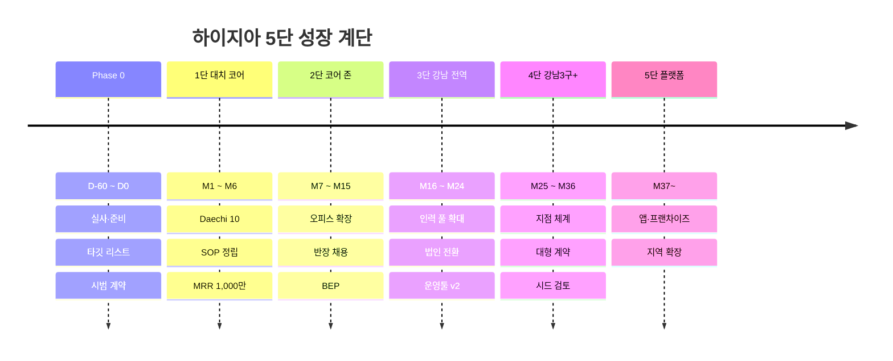
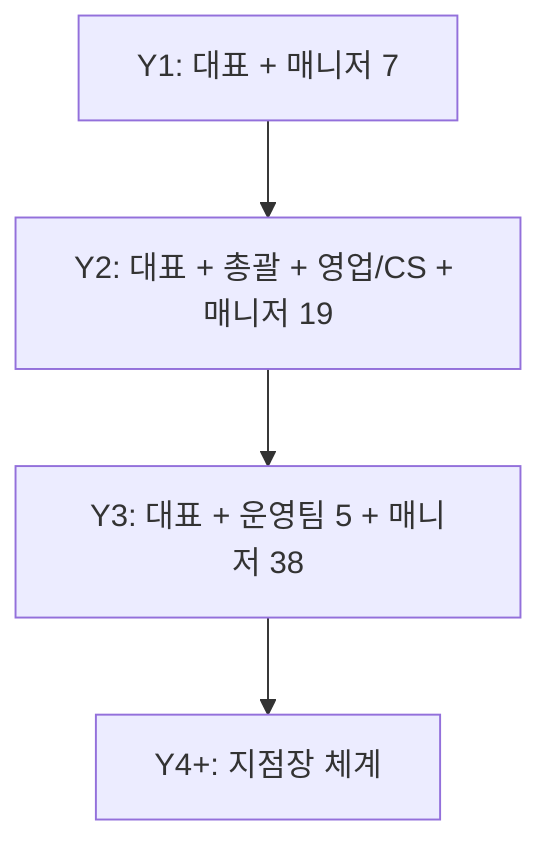

# 08. 로드맵 · KPI · 실행 계획

> **Hygeia Stairs — 5단 성장 계단.** 각 단계는 **게이트 지표**를 통과해야 다음 단으로 올라갑니다.
> 가장 위험한 실수는 "계단을 건너뛰는 것"(증명 전 확장)입니다.

---

## 1. 5단 계단 로드맵

| 단계 | 기간 | 지리 | 핵심 목표 | 인력 | 고정비 증설 |
|------|------|------|-----------|------|-------------|
| **Phase 0** | D-60~D0 | 대치동 | 실사·인허가·세팅·시범 계약 | 대표 | 최소 |
| **1단** | M1~M6 | 대치동 코어 | 레퍼런스 10건, SOP, MRR 1,000만 | 매니저 3~4 | 보류 |
| **2단** | M7~M15 | 반경 2km | 오피스 확장, **BEP**, 반장 채용 | 매니저 7 | 반장 |
| **3단** | M16~M24 | 강남구 전역 | 5인 임계 관리, 법인 전환, 운영툴 | 매니저 19 | 영업·CS |
| **4단** | M25~M36 | 강남3구 + | 지점·조 운영체계, 대형 계약 | 매니저 38 | 운영팀 5 |
| **5단** | M37~ | 수도권 | 플랫폼·프랜차이즈 | — | 투자 |

---

## 2. 단계별 게이트 지표

| 이동 | 통과 조건 (모두 충족) |
|------|------------------------|
| **Phase 0 → 1단** | 시범 계약 의향 10건 확보, 영업배상보험·사업자 등록 완료, 매니저 2명 확보 |
| **1단 → 2단** | MRR ≥ **1,000만**, 재청소율 ≤ 3%, 월 이탈 ≤ 5%, 후기 8건+, 2개 세그먼트 마진 ≥ 35% |
| **2단 → 3단** | **월 BEP 달성**, 인시당 매출 ≥ 33,000원, 매니저 이탈 ≤ 5%/월, 현금 3개월 확보 |
| **3단 → 4단** | MRR ≥ 6,000만, 영업이익률 ≥ 5%, SOP 인수인계 가능(대표 현장 투입 < 20%) |
| **4단 → 5단** | 3개 이상 조(지점) 독립 운영, 운영툴 안정, 반복 가능성 증명 |

---

## 3. Phase 0 — 90일 이전 준비 (D-60 ~ D0)

### 주별 실행표

| 주차 | 활동 | 산출물 |
|------|------|--------|
| D-60~D-53 | 건축물대장·구청 데이터로 코어 존 타깃 리스트 구축 (빌라·오피스·숙박) | 엑셀 리스트 500건 |
| D-52~D-46 | 빌라 20곳 방문 인터뷰, 호스트 10명, 오피스 5곳 인터뷰 | 인터뷰 노트 |
| D-45~D-39 | 경쟁사 가격 미스터리 쇼핑 5곳, 가격표 초안 | 가격 벤치마크 |
| D-38~D-32 | 사업자 등록, 세무사·노무사 상담, 보험 견적 | 사업자번호 |
| D-31~D-25 | 브랜드(로고·유니폼·소개서), 노코드 운영툴(시트·알림톡) 세팅 | 브랜드킷 |
| D-24~D-18 | 매니저 채용 공고, 면접, 장비·자재 구매 | 매니저 2~3명 |
| D-17~D-11 | 체크리스트·SOP 작성, **모의 청소 3회**로 시간 측정 | SOP v1 |
| D-10~D-0 | 시범 계약 의향 확보 (빌라 5, 숙박 3, 오피스 1~2) | 시범 계약 10건 |

### 가정 검증 체크리스트 (Phase 0 종료 전 반드시)
- [ ] 코어 존 빌라 동수 / 접근 가능 비율
- [ ] 숙박 합법 숙소 비율 및 고객 풀
- [ ] 인시당 소요 시간 실측 (모의 청소 3회 평균)
- [ ] 매니저 시급·가동률 가정 확인
- [ ] 가격표 +10~20% 프리미엄 수용성
- [ ] 정책자금 한도·금리

---

## 4. 1단 — 첫 90일 상세 (M1~M3)

| 월 | 목표 | 핵심 활동 |
|----|------|-----------|
| **M1** | 계약 4건, MRR 250만 | 시범 전환, 비포/애프터, 현장 동선 정립, 일일 보고 |
| **M2** | 계약 누적 9건, MRR 400만 | 이웃 건물 DM 2차, 호스트 커뮤니티 콘텐츠, 매니저 +1 |
| **M3** | 계약 누적 12건, **MRR 530만** | 후기 확보, 가격 확정, 부동산 제휴 3곳 |

**주간 리듬**: 월(배차·점검), 수(영업 회의), 금(주간 리포트·고객 피드백).

---

## 5. KPI 대시보드

### 5.1 성장
| 지표 | M3 | M6 | M12 | M24 |
|------|-----|-----|------|------|
| MRR | 530만 | 1,090만 | 2,210만 | 6,230만 |
| 빌라(동) | 6 | 10 | 20 | 50 |
| 오피스(곳) | 0 | 1 | 3 | 8 |
| 숙박(객실) | 6 | 11 | 20 | 60 |
| 매니저(명) | 3 | 4 | 7 | 19 |

### 5.2 품질·운영
| 지표 | 목표 |
|------|------|
| 재청소율 | ≤ 3% |
| 고객 평점 / NPS | 4.8+ / 50+ |
| 시간 준수율 | ≥ 98% |
| 사진 보고 제출률 | 100% |
| **인시당 매출** | **≥ 33,000원** |
| **이동시간 비율** | **≤ 12%** |
| 가동률 | ≥ 75% |
| 매니저 이탈률(월) | ≤ 5% |
| 고객 이탈률(월) | 빌라·오피스 ≤ 3% / 숙박 ≤ 8% |

### 5.3 재무
| 지표 | 목표 |
|------|------|
| 공헌이익률 | Y1 38% → Y3 42% |
| CAC 회수 | ≤ 3개월 |
| 미수금 회전 | ≤ 30일 |
| 현금 보유 | ≥ 고정비 3개월 |
| 숙박 매출 비중 | ≤ 65% |

---

## 6. 조직 구조 진화

| 시점 | 핵심 역할 |
|------|-----------|
| Y1 | 대표(영업·품질), 현장반장 1(M7~) |
| Y2 | 현장총괄, 영업·CS(M19~), 반장 |
| Y3 | 총괄·반장 2·영업·CS/배차 |

---

## 7. 즉시 실행 체크리스트 (이번 주)

1. [ ] 확정 필요 정보 회신 (README의 "정밀화 정보 6가지")
2. [ ] 건축물대장 개방 API로 대치동 4층 이하·4~16세대 건물 추출
3. [ ] 강남구청 사전정보공표에서 외국인관광 도시민박업 등록 현황 다운로드
4. [ ] 빌라 인터뷰 5건 시작
5. [ ] 세무사·노무사 상담 예약
6. [ ] 소상공인시장진흥공단·서울신용보증재단 자금 상담 예약

---

## 8. 도메인 확장 아이디어 (4~5단 옵션)

| 아이디어 | 설명 |
|----------|------|
| 학원·스터디카페 정기 청소 | 대치동 특화 4번째 세그먼트, 야간·주말 |
| 린넨 렌탈·풀링 센터 | 숙박 마진 개선, 별도 수익원 |
| 시설 점검·소모품 정기 배송 | 오피스·빌라 소모품 구독 |
| 청소 인력 앱·플랫폼 | 운영 데이터·배차 자동화를 외부 판매 |
| 프랜차이즈/지역 제휴 | 강남 외 지역 확장 |

---

## 9. 부록 — 의사결정 요약

| 질문 | 현재 결론 |
|------|-----------|
| 첫 세그먼트는? | **빌라 + 숙박 동시**(현금·밀도), 오피스는 M4~ 레퍼런스 후 |
| 인력 고용 형태 | 근로계약(정규 40%·파트 60%) |
| 가격 전략 | 시장 +10~20% 프리미엄 + 증빙 |
| 숙박 정책 | 합법 숙소 우선, 비중 65% 이내 |
| 자금 | 약 1억(자기 5,000 + 정책 5,000) |
| 창업 시작 | 2027년 1월 (겨울 비수기에 빌라·SOP 숙련 → 봄 성수기 진입) |
