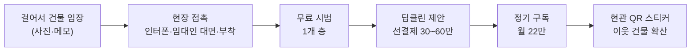
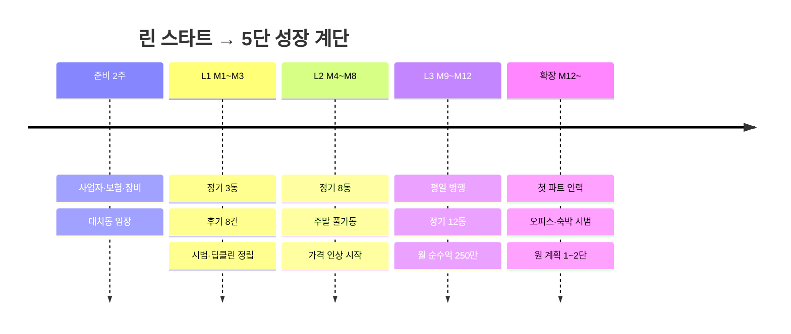

# 09. 린 스타트 계획 — 자본금 300만 원, 1인, 주말 빌라 청소부터

> **이 문서가 "실제 시작" 계획입니다.**
> 02~08 문서는 *팀·차량·사무실·1억 원 자금*을 전제로 한 **스케일업 시나리오(목표 규모)** 이고,
> 이 문서는 *대표님의 실제 조건*에서 출발해 거기까지 올라가는 **첫 계단**을 설계합니다.

---

## 1. 출발 조건 (대표님 답변 반영)

| 항목 | 내용 | 계획에 미치는 영향 |
|------|------|---------------------|
| 자본금 | **300만 원** | **무대출 원칙**. 장비·보험·인쇄 최소 투자로 시작, 번 돈으로만 확장 |
| 인력 | 처음엔 **혼자**, 직접 청소 | 대표 인건비 = 순수익. 체력·시간이 곧 생산능력 |
| 프로필 | 50세 남성, **빌라 청소 3년 + 빌딩 청소 1년** | 현장 숙련도가 최대 자산. 소요시간·단가를 이미 안다 |
| 인맥 | 없음 | **오프라인 현장 영업(방문·부착)** 중심. 소개 의존 모델은 초기 제외 |
| 차량·사무실 | 없음 | **대중교통 + 도보 동선**, 자택 주소로 사업자 등록 |
| 시작 | 바로, **주말 일감부터** | 주말에 몰아서 정기 방문 구조 설계 |

### 이 조건에서 달라지는 전략 4가지

1. **세그먼트는 "빌라 하나"로 좁힌다.**
   오피스는 영업 주기가 길고 인맥이 필요하며, 숙박은 규제 이슈와 호스트 인맥이 필요하다.
   빌라 공용부는 *본인 경력이 가장 강하고*, 인맥 없이 *현장 방문*으로 영업할 수 있고, *주말*에 영업·작업이 모두 가능하다.
2. **동선은 "걸어서 닿는 건물 묶음"으로 설계한다.**
   차량이 없으므로 한 골목 안 3~4동을 묶어 하루 4동을 도보로 돈다.
   (대치4동 같은 저층 주거 밀집 지역이 유리)
3. **돈을 버는 순서는 "딥클린 → 정기 전환"이다.**
   딥클린은 시간당 수익이 정기 방문의 2배 이상이고 선결제 현금이 들어온다. 결과가 눈에 보이니 정기 계약도 쉬워진다.
4. **혼자 하는 사업의 최대 리스크는 '본인 몸'이다.**
   부상·질병 = 매출 0. 안전수칙, 보험, 대체 인력 네트워크를 첫날부터 설계한다.

---

## 2. 사업 모델 (솔로 버전)

### 2.1 상품 구성

| 상품 | 대상 | 가격(가정) | 역할 |
|------|------|-----------|------|
| **정기 구독 Lite** | 3층 이하·8세대 이하 빌라 계단·복도·현관, 주 1회 | **월 22만 원** | 안정 수입(핵심) |
| **원데이 계단 청소** | 같은 규모, 1회성 | 10~12만 원 (4~5층 15~20만) | 시범·주말 단건 |
| **초기 딥클린** | 묵은 때·곰팡이·얼룩 | **30~60만 원** (선결제) | 현금 + 정기 전환 |
| **무료 시범** | 1개 층 계단 | 0원 | 신뢰·사진 확보 (주 2건 한도) |

> **가격 원칙**: 시작 가격은 본인이 3년간 알던 **시장가와 같거나 최대 +10%**. 후기 10건이 쌓이면 신규 계약부터 +10~20% 인상.
> 대치동 프리미엄은 "레퍼런스가 생긴 뒤"에 받는다.

### 2.2 시간당 수익 점검 (본인 노동 기준)

| 상품 | 매출 | 투입 시간(이동 포함) | **시간당** |
|------|------|--------------------|-----------|
| 정기 Lite(회당) | 약 5.1만 | 2h | 약 2.5만 원 |
| 원데이 청소 | 12만 | 2.5h | 약 4.8만 원 |
| 딥클린 | 40만 | 6h | **약 6.7만 원** |

→ **신규 건물은 "시범 → 딥클린 제안 → 정기 전환"** 순으로 설계한다.

### 2.3 주말 하루 일정 (도보 동선, 하루 4동)

| 시간 | 내용 |
|------|------|
| 09:00~10:30 | A동 (소음 민원 방지: 진공·물청소는 **오전 9시 이후**) |
| 10:50~12:20 | B동 |
| 12:20~13:20 | 점심·휴식·사진 정리 |
| 13:20~14:50 | C동 |
| 15:10~16:40 | D동 |
| 17:00~ | 고객 보고(카톡 사진), 장부 정리 |

- 주말 용량 ≈ **주 8방문**(토 4 + 일 4). → **정기 고객 8동 = 주말 풀가동**
- 정기 방문은 건물마다 **요일·시간 고정**(예: 토 09:00) → 습관·신뢰 형성

---

## 3. 초기 예산 300만 원

| 항목 | 금액 | 비고 |
|------|------|------|
| 장비·소모품 | 약 100만 | 건습식 소형 청소기, 대걸레·스퀴지·솔 세트, 마이크로화이버, 양동이, **중성/곰팡이/스케일 제거 세제**, 보호구, 접이식 카트 |
| **영업배상책임보험** | 약 25만 | 연간, 견적 3곳 비교 [확인필요] |
| 인쇄·홍보물 | 약 30만 | 명함, 현관 부착용 안내문, 우편함 DM 1,000매, 건물 QR 스티커 |
| 온라인 세팅 | 약 10만 | 네이버 플레이스·당근 비즈프로필·카톡 채널(무료), 간단 로고 |
| 유니폼 조끼·신발 | 약 10만 | 신뢰감 + 안전화 |
| 교통·운영 예비 | 약 60만 | 월 20만 × 3개월 |
| **예비비** | 약 65만 | 장비 보충, 사고·분실 대응 |
| **합계** | **300만** | **대출 0** |

> 큰 장비(고압세척기·스팀기 등)와 차량은 **번 돈으로 단계별 구입**. 필요 시 대형 딥클린 때만 카셰어링·장비 대여 활용.

---

## 4. 영업 전략 — 인맥 0에서 고객 만들기

### 4.1 영업 퍼널

| 채널 | 방법 | 비용 | 비고 |
|------|------|------|------|
| **현장 임장·접촉** | 주말에 대치4동 중심 걸으며 관리 안 된 빌라 사진 → 임대인 거주 세대에 인터폰/우편함 | 0원 | **임대인이 주말에 집에 있어 주말 영업 효율 높음** |
| 안내문·QR | 현관 부착은 **허락받고** 부착(무단 부착은 민원 위험) | 인쇄비 | 작업 중 건물에서 곧바로 영업 |
| 당근 비즈프로필 | "대치동 빌라 계단·공용부 청소" 후기·비포/애프터 | 0원 | 후기 쌓기 핵심 |
| 네이버 플레이스 | 영업지역 설정(자택 주소 노출은 설정 확인) [확인필요] | 0원 | 후기 키워드 |
| **숨고 등 견적 플랫폼** | 주말 단건 일감·후기 확보 | 견적당 비용 | 초기 레퍼런스용, 장기 의존 금지 |
| 부동산 중개사무소 | 대치동 중개소 방문, "건물 관리 의뢰 소개" 부탁 | 소개비(첫 3개월 10%) | 인맥 대체 수단 |

### 4.2 월별 영업 목표 (보수적)

| 지표 | 목표 |
|------|------|
| 월 현장 접촉 | **건물 50~100동** |
| 상담 | 10~15건 |
| 시범 | 6~8건 |
| **신규 정기 계약** | **월 1~2동** |

> 월 신규 1동이면 6개월 후 정기 6동, 12개월 후 12동입니다. 너무 느려 보여도 **1인 체제의 안전한 속도**입니다.

### 4.3 이전 경력 활용 시 주의
- 이전 고용주와의 **고객 유인 금지·경업금지 약정**이 있는지 확인하세요 [확인필요].
- 이전 고객에게 연락하기 전에 계약서·분쟁 가능성부터 점검하세요.

---

## 5. 월별 손익 계획 (1인, 대표 인건비 = 순수익)

가정: 정기 22만/동, 단건 평균 10만, 변동비(정기 동당 월 2.5만 · 단건 건당 1.5만), 고정비 월 10만(보험 분할·통신·광고).

| 월 | 정기(동) | 단건(건) | 매출 | 변동비+고정비 | **순수익(세전)** |
|----|---------|---------|------|-------------|------------------|
| M1 | 1 | 2 | 42만 | 15만 | **약 26만** |
| M2 | 2 | 3 | 74만 | 20만 | 약 55만 |
| M3 | 3 | 4 | 106만 | 24만 | 약 83만 |
| M4 | 4 | 4 | 128만 | 26만 | 약 102만 |
| M5 | 5 | 4 | 150만 | 29만 | 약 122만 |
| M6 | 6 | 5 | 182만 | 33만 | **약 150만** |
| M8 | 8 | 4 | 216만 | 36만 | 약 180만 |
| M12 | 12 | 4 | 304만 | 46만 | **약 258만** |

- **1년 합계(추정)**: 매출 약 **2,180만**, 순수익 약 **1,800만** (세전, 건보료·소득세 미반영).
- **투자 회수**: 실제 지출 약 235만 → **M4에 누적 순수익이 초과**
- **세금·건보료 예비**: 순수익의 10~15%를 별도 보관 [가정]
- 가정은 모두 **[가정]** — 첫 4주에 실제 시간·단가·전환율로 교체

> [!IMPORTANT]
> **정기 8동은 주말 풀가동 한계**입니다. (M8 전후)
> 이후 선택지는 **① 평일 일부 투입 ② 신규 계약 단가 인상 ③ 첫 파트 인력 채용** 중 하나입니다.

---

## 6. 단계별 로드맵 — 린 스타트에서 정식 계단으로

| 단계 | 기간 | 목표 | 통과 조건(게이트) |
|------|------|------|-------------------|
| **준비** | D-14~D0 | 사업자·보험·장비·온라인 세팅 | 보험 가입, 시범 대상 건물 30동 리스트 |
| **L1** | M1~M3 | 정기 3동, 후기 8건 | 재청소 요청 0~1건, 월 순수익 ≥ 80만 |
| **L2** | M4~M8 | 정기 8동 (주말 풀) | 월 순수익 ≥ 180만, 신규 계약 단가 +10% 적용 |
| **L3** | M9~M12 | 평일 병행, 정기 12동 | 월 순수익 ≥ 250만, **대기 고객 3동 이상** |
| **확장** | M12~ | **첫 파트 인력** + 오피스·숙박 시범 | 위 3개 + 대표 체력·시간 여유 확인 |

### 원 계획(02~08)과의 연결

| 린 스타트 단계 | 원 계획 대응 |
|----------------|--------------|
| L1~L3 | **1단 대치 코어의 "미니 버전"** (빌라만, 1인) |
| 첫 파트 인력 채용 | 04 운영 문서의 **A조/B조·SOP·교육** 도입 시작 |
| 정기 12동 + 월 순수익 250만 | 06 재무 문서 **Y1 중반 수준**에 해당, 이때부터 06의 비용 구조를 단계 적용 |
| 오피스·숙박 시범 | 02·03·05 문서의 **세그먼트 확장** 단계 |

---

## 7. 개업 준비 2주 실행표

오늘은 금요일입니다. **이번 주말(10/24~25)부터 임장**을 시작하세요.

| 시기 | 할 일 |
|------|------|
| **이번 주말 (10/24~25)** | 대치동(특히 대치4동) 도보 임장 — 건물 50동 사진·메모, 관리 상태 평가, 중개사무소 위치 파악 |
| 월~화 | **사업자 등록(홈택스, 간이과세 검토)**, 자택 주소 사용 가능 여부 확인 |
| 화~수 | **영업배상책임보험 견적 3곳**, 개인 상해보험 점검 |
| 수~목 | 장비·세제 구매(필수 품목만), 보호구·안전화 |
| 목~금 | 안내문·명함·QR 스티커 인쇄, 네이버 플레이스·당근·카톡 채널 개설, 고객 장부 시트 |
| **11/1~2 (주말)** | **D-Day**: 임장 + 첫 무료 시범 2건, 현장 접촉 시작 |
| 11/8~9 | 시범 결과 정리, 딥클린 제안서(전/후 사진) 완성, 첫 정기 계약 목표 |

### 준비 단계 체크리스트
- [ ] 사업자 등록증 (업종·주소)
- [ ] 영업배상책임보험 증권
- [ ] 장비 세트 + 세제 안전 확인(염소계+산성 혼합 금지)
- [ ] 안내문·명함·QR 스티커
- [ ] 계약서 1장 템플릿([07 문서](07_legal_risk.md) 7절 참고)
- [ ] 고객 장부(주소·요일·요금·입금일·특이사항)
- [ ] 가격표(정기·원데이·딥클린)

---

## 8. 운영 원칙 (솔로 버전)

| 원칙 | 내용 |
|------|------|
| **사진 보고** | 방문마다 전/후 사진을 카톡으로 발송(스마트폰만으로 충분) |
| **월 선불** | 월 초 계좌이체 선결제. 연체 7일 시 방문 일시 중지. 현금 흐름·이탈 방지에 모두 유리 |
| **고정 요일·시간** | 건물별로 같은 요일·시간에 방문 |
| **전화 응대** | 작업 중엔 못 받으므로 카톡 채널 **자동응답 + 저녁 일괄 회신** |
| **소음 시간** | 주말 오전 9시 이전·저녁 늦은 시간 작업 금지 |
| **안전** | 물청소 후 계단 **미끄럼 주의 표지**, 약품 혼용 금지, 장갑·마스크, 무리한 외벽·고소 작업 금지 |
| **본인 건강** | 주 2일 연속 고강도 작업이므로 스트레칭·무릎/허리 보호구, 월 1회 휴식 주말 확보 |
| **대체 인력** | 전 직장 동료·지인 중 급할 때 **대신 투입 가능한 1~2명**을 미리 확보 |

---

## 9. 세무·법규 (솔로 버전 요약)

| 항목 | 내용 |
|------|------|
| 사업자 | **개인사업자, 간이과세 가능 여부 검토** (연 매출 규모에 따라, 세금계산서 발행 필요성 확인) [확인필요] |
| 주소 | 자택 주소 등록 가능 여부(임차 주택은 임대인 동의 필요 가능) [확인필요] |
| 직원 | 없음 → 4대보험 직장가입 의무 없음. 본인은 지역가입자 |
| 산재 | 근로자 없는 사업주도 **임의 가입** 가능한 제도 확인 [확인필요] |
| 보험 | **영업배상책임보험 필수** (계단 미끄러짐 사고 대비) |
| 감면 | 대표 50세 → **청년창업 세액감면 대상 아님**. 서울은 과밀억제권역이라 일반 창업 감면도 제한 가능 [확인필요] |
| 폐기물 | 분리수거 정리만. 수거·운반은 제외 |
| 세금 예비 | 소득세·건보료 인상분 대비 **월 순수익의 10~15% 별도 보관** |

> 지원 제도: **서울시50플러스재단**(중장년 창업 교육·컨설팅), **소상공인시장진흥공단 무료 교육·컨설팅**을 확인해 보세요 [확인필요]. 300만 원 단계에서는 **대출은 불필요**합니다.

---

## 10. 솔로 사업 리스크와 대응

| 리스크 | 가능성 | 영향 | 대응 |
|--------|--------|------|------|
| **부상·질병** | 중 | 높음 | 안전수칙, 휴식 주말, 대체 인력 1~2명, 상해보험 |
| **계단 낙상 사고(주민)** | 중 | 높음 | **배상책임보험**, 물청소 직후 미끄럼 표지 |
| **영업이 느림** | 높음 | 중 | 월 접촉 목표 관리, 중개소·당근·숨고 병행, 딥클린으로 단건 현금 확보 |
| **인맥 부재로 신뢰 확보 어려움** | 높음 | 중 | 무료 시범 + 사진 보고 + 후기, 유니폼·명함, 월 선불 대신 첫 달 후불 옵션 |
| **가격 압박** | 중 | 중 | 가격 공개 대신 시범 결과로 제안, 번들·장기 계약 할인 |
| **체력 한계(정기 8동 이상)** | 높음 | 중 | 평일 병행, 단가 인상, 첫 파트 인력 |
| **이전 직장 분쟁** | 낮음 | 중 | 계약서 확인, 이전 고객 직접 유인 금지 |
| **현금 300만 소진** | 낮음 | 높음 | 무대출, 예비비 65만 유지, 장비는 필수만 |
| **건물 내 도구 보관 문제** | 중 | 낮음 | 건물에 도구함 허락 요청, 불가 시 접이식 카트 휴대 |

### 중단·피벗 기준
| 시점 | 기준 | 조치 |
|------|------|------|
| M2 | 시범 4건 미만 또는 접촉 50동 미만 | 영업 방식·지역·메시지 재설계 |
| M3 | 정기 계약 2동 미만 | 가격·상품(원데이 중심)·타깃 건물 재검토, 숨고 병행 |
| M6 | 월 순수익 80만 미만 | 평일 부업 병행 또는 단건·딥클린 중심으로 전환 |
| 상시 | 현금 예비비 30만 미만 | 신규 지출 동결 |

---

## 11. 정리 — 대표님께 드리는 핵심 조언

1. **욕심내지 말고 빌라 하나에 집중**하세요. 오피스·숙박은 정기 8~12동 이후입니다.
2. **영업이 사업의 80%**입니다. 청소는 이미 잘하시니, **주말마다 건물 50동을 걷는 습관**이 성패를 가릅니다.
3. **딥클린이 돈이 되고, 정기가 사업이 됩니다.** 딥클린으로 현금을 만들고, 정기로 안정을 쌓으세요.
4. **본인 몸이 자본**입니다. 보험·휴식·대체 인력을 첫날부터 챙기세요.
5. 첫 90일 목표는 단 하나: **정기 3동 + 후기 8건**. 이게 되면 나머지는 따라옵니다.

### 다음에 알려주시면 더 정밀해지는 정보
1. **거주지**(대치동까지 이동 시간·교통수단)
2. **평일 가용 시간**(영업·딥클린을 평일에 할 수 있는지)
3. **본업/생계 여부**(월 최소 필요 소득과 버틸 수 있는 기간)
4. 전 직장에서 쓰던 **실제 단가·소요시간**(가격표 보정)
5. 이전 고용주와의 경업금지/고객유인 금지 약정 여부
