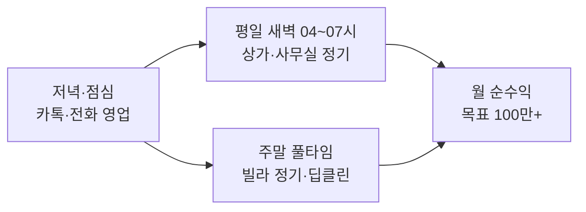
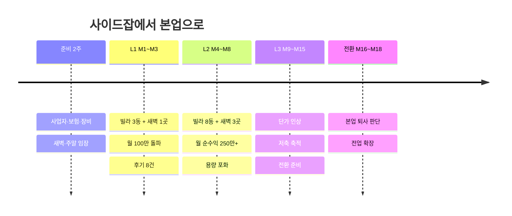

# 09. 린 스타트 계획 — 사이드잡으로 시작해 본업으로 키우는 대치동 청소 사업

> **이 문서가 "실제 시작" 계획입니다.**
> 02~08 문서는 *팀·차량·사무실·1억 원 자금*을 전제로 한 **스케일업 시나리오(목표 규모)** 이고,
> 이 문서는 *대표님의 실제 조건*에서 출발해 거기까지 올라가는 **첫 계단**을 설계합니다.

---

## 1. 출발 조건 (대표님 답변 반영)

| 항목 | 내용 | 계획에 미치는 영향 |
|------|------|---------------------|
| 자본금 | **300만 원** | **무대출 원칙**. 장비·보험·인쇄 최소 투자, 번 돈으로만 확장 |
| 형태 | **본업(세전 240만 원, 실수령 약 214만 원) 유지 + 사이드잡**, 잘 되면 본업 전환 | 본업 소득이 기본 생계 안전망. 대신 **겸업·체력·시간**이 핵심 제약 |
| 본업 시간 | **평일 09:00 ~ 18:00** | 출퇴근(대치동 인근 전제) 고려 시 새벽 04:00~07:30 활용, 저녁은 휴식/고객 상담 |
| 목표 | 부수입으로 **순수익 월 100만 원 이상** (총 실수령 314만~340만 원 이상 확보) | 1차 목표는 *사이드잡 월 순수익 100만 원 돌파* |
| 거주지 | **서울 대치동** | **전 구간 도보 이동**. 이동비·이동시간 거의 0 → 막강한 원가 경쟁력 |
| 평일 시간 | **새벽 4~7시** (3시간) | **무소음 빌라 청소**(10번 문서) 및 **상가·사무실·학원 공용부** 가능 |
| 주말 | **풀타임 가능** | 주말에 **빌라 공용부 집중 작업 및 현장 대면 영업·딥클린** |
| 프로필 | 50세 남성, 빌딩 청소 1년 + 빌라 청소 3년 | 빌딩·빌라 **두 영역 모두 숙련** → 상품 다양화 가능 |
| 인맥·차량·사무실 | 없음 | 오프라인 현장 도보 영업, 자택 주소 사업자 |

### 이 조건에서 정한 전략 6가지

1. **평일 새벽 = 무소음 빌라 + 상가·사무실, 주말 = 빌라 정기 + 딥클린.**
   - [10. 무소음 빌라 청소 가이드](10_silent_villa_cleaning.md)의 원칙(정전기 부직포 밀대, 사전 적심 극세사 패드, 쿠션 슬리퍼, 05:30 이후 실내 진입)을 적용하여 **평일 새벽에도 소음 민원 제로로 빌라 청소를 수행**합니다.
   - 불빛과 소음에 민감하지 않은 상가·학원·사무실은 04:00~05:30 초새벽에, 빌라는 05:30~07:00에 배치합니다.
2. **대치동 거주 = 도보 동선 = 구조적 원가 우위.**
   차량·교통비가 없고, 한 골목 안 건물을 묶어 하루에 여러 곳을 돕니다.
3. **영업은 주말 대면과 저녁 연락으로 분리.**
   평일 낮(09~18시)은 본업에 집중하고, 새벽엔 *임장(건물 상태 확인)*, 주말엔 *대면 영업/시범*, 저녁(18:30~)엔 *카톡·전화 일괄 회신*.
4. **"딥클린 → 정기 전환"으로 현금과 후기를 먼저 만든다.**
5. **사이드잡 상한은 월 순수익 약 250~280만 원.** 이후는 **전업 전환 판단**이다.
6. **가장 큰 리스크는 체력·수면·겸업 규정**이다. 사업 아이디어가 아니라 *대표님 몸과 건강*이 병목이다.

---

## 2. 사업 모델

### 2.1 상품 구성

| 구분 | 상품 | 대상 | 가격(가정) | 시간대 |
|------|------|------|-----------|--------|
| 평일 새벽 | **무소음 빌라 정기** ([10번 SOP](10_silent_villa_cleaning.md)) | 3~5층 빌라 계단·복도·현관, 주 1회 | **월 22만 원** | 평일 05:30~07:00 |
| 평일 새벽 | **상가 건물 공용부 정기** | 소형 상가·근린생활 건물(4~6층) 계단·복도·로비·공용화장실, **주 2회** | **월 40만 원** | 평일 04:00~06:00 |
| 평일 새벽 | **소형 사무실·학원 정기** | 30평 이하, **주 3회** | **월 50~60만 원** | 평일 04:00~06:00 |
| 주말 | **빌라 정기 Lite/Standard** | 3~5층 빌라 계단·복도·현관·분리수거, 주 1회 | **월 22만~38만 원** | 주말 09:00~16:00 |
| 단건 | **원데이 계단 청소** | 위 규모의 1회성 | 10~12만 원 (4~5층 15~20만) | 주말 |
| 단건 | **초기 딥클린** | 묵은 때·곰팡이·얼룩 | **30~60만 원** (선결제) | 주말 |
| 시범 | **무료 시범** | 1개 층 계단 | 0원 (주 2건 한도) | 주말 |

> **가격 원칙**: 시작 가격은 대표님이 4년간 아는 **시장가와 같거나 최대 +10%**. 후기 10건이 쌓이면 *신규 계약부터* +10~20% 인상.
> 가격은 **[가정]** 이며, 전 직장의 실제 단가로 보정하세요.

### 2.2 시간당 수익 점검 (본인 노동 기준)

| 상품 | 매출 | 투입 시간 | **시간당** |
|------|------|-----------|-----------|
| 빌라 정기(회당) | 약 5.1만 | 1.7h (도보 이동 포함) | 약 3.0만 원 |
| 상가·사무실 정기(회당, 주2회 40만 기준) | 약 4.65만 | 1.5h | 약 3.1만 원 |
| 원데이 청소 | 12만 | 2.5h | 약 4.8만 원 |
| 딥클린 | 40만 | 6h | **약 6.7만 원** |

→ **신규 건물은 "시범 → 딥클린 제안 → 정기 전환"** 순으로.

### 2.3 주간 시간표

**주말 (토·일, 하루 4동 도보)**

| 시간 | 내용 |
|------|------|
| 09:00~10:30 | A동 (소음 민원 방지: 진공·물청소는 **오전 9시 이후**) |
| 10:40~12:10 | B동 |
| 12:10~13:00 | 점심·휴식 |
| 13:00~14:30 | C동 |
| 14:40~16:10 | D동 |
| 16:30~18:00 | 현장 영업(인터폰·부착·중개소), 사진 정리·고객 보고 |

→ 주말 용량 ≈ **주 8방문** (토 4 + 일 4)

**평일 새벽 (월·수·금 권장, 하루 2곳)**

| 시간 | 내용 |
|------|------|
| 04:00~05:20 | 건물 A (작업 80분, **무소음 중심**) |
| 05:30~06:50 | 건물 B |
| 07:00 | 사진 보고 → 샤워·출근 준비 |

→ 새벽 용량 ≈ **주 6방문** (월수금 × 2곳). 3곳을 주 2회씩 도는 구조.

> [!WARNING]
> **주 7일 근무 구조**입니다(본업 5일 + 새벽 3일 + 주말 2일).
> 시작 3개월은 **새벽 주 2일**로 줄이고, **월 1회는 완전한 휴식 주말**을 확보하세요. 수면 6.5시간 확보가 최우선입니다. 본업 성과가 떨어지면 전체 계획이 무너집니다.

---

## 3. 초기 예산 300만 원

| 항목 | 금액 | 비고 |
|------|------|------|
| 장비·소모품 | 약 100만 | 건습식 소형 청소기, 대걸레·스퀴지·솔, 마이크로화이버, 중성/곰팡이/스케일 제거 세제, 보호구, 접이식 카트 |
| **영업배상책임보험** | 약 25만 | 연간, 견적 3곳 비교 [확인필요] |
| 인쇄·홍보물 | 약 30만 | 명함, 건물 안내문, 우편함 DM, 건물 QR 스티커 |
| 온라인 세팅 | 약 10만 | 네이버 플레이스·당근 비즈프로필·카톡 채널(무료), 간단 로고 |
| 유니폼·안전화·헤드랜턴 | 약 10만 | 새벽 작업 안전·신뢰감 |
| 운영 예비 | 약 40만 | 도보 이동이라 교통비 최소, 소모품 보충 |
| **예비비** | 약 85만 | 장비 보충, 사고·분실 대응 |
| **합계** | **300만** | **대출 0** |

> 고압세척기·스팀기·차량은 **번 돈으로 단계 구입**. 대형 딥클린 때만 장비 대여·카셰어링 활용.

---

## 4. 영업 전략 — 인맥 0, 평일 낮 불가 상태에서 고객 만들기

### 4.1 퍼널

| 채널 | 방법 | 비용 | 비고 |
|------|------|------|------|
| **새벽 임장** | 평일 새벽에 대치동 상가·학원 건물을 걸으며 *관리 상태·관리실 연락처·출입 방식·쓰레기 배출 상태* 기록 | 0원 | 새벽에 *건물의 민낯*이 보인다. 영업 목록을 만드는 시간 |
| **주말 현장 영업** | 빌라 임대인(주말 거주 중)·상가 관리인에게 인터폰/방문 | 0원 | 학원은 주말에도 운영해 관리자 접촉 가능 |
| 안내문·QR | 허락받고 건물 입구 부착 | 인쇄비 | 작업 중인 건물이 곧 광고판 |
| **저녁·점심 카톡/전화** | 문의 회신을 **저녁 일괄**, 점심시간 짧게 | 0원 | 평일 낮 영업 불가를 대체 |
| 당근 비즈프로필 | 비포/애프터·후기 | 0원 | 후기 쌓기 핵심 |
| 네이버 플레이스 | 영업지역 설정(자택 주소 노출 설정 확인) [확인필요] | 0원 | |
| 숨고 등 견적 플랫폼 | 주말 단건·후기 확보 | 견적당 비용 | 초기 레퍼런스용, 장기 의존 금지 |
| 대치동 부동산·학원 협회 | 중개소 방문, "건물 관리 의뢰 소개" 요청 | 소개비(첫 3개월 10%) | 인맥 대체 |

### 4.2 월별 영업 목표 (보수적)

| 지표 | 목표 |
|------|------|
| 현장 접촉 | **건물 50~100동/월** |
| 상담 | 10~15건 |
| 시범 | 6~8건 |
| **신규 정기 계약** | **빌라 월 1동 + 상가·사무실 2개월에 1곳** |

### 4.3 새벽 작업 신뢰 확보 (상가·사무실 필수)

새벽에 **혼자 건물에 출입**하는 서비스이므로, 신뢰가 가격보다 먼저입니다.

| 장치 | 내용 |
|------|------|
| 서류 | 사업자등록증, 보험증권, 신분증 사본 제공, **표준 계약서** |
| 출입 | 도어락 **전용 코드(일회성 변경 가능)** 또는 키박스. 열쇠는 반드시 로그 |
| 증빙 | 입실·퇴실 **타임스탬프 사진**, 작업 전/후 사진 |
| 분쟁 방어 | **CCTV 있는 건물 우선**. 개인 물품·서류는 절대 만지지 않음 |
| 소음 | 새벽엔 **무소음 중심**(마른·습식 걸레, 쓰레기 정리). 진공·고압 세척은 사전 협의 시에만 |

### 4.4 이전 경력 활용 시 주의
- 이전 고용주와의 **고객 유인 금지·경업금지 약정**이 있는지 확인하세요 [확인필요].
- **현재 본업 회사의 겸업 금지 규정**은 더 중요합니다 → 9절.

---

## 5. 월별 손익 계획 (사이드잡 모델, 대표 인건비 = 순수익)

**가정(모두 [가정])**: 빌라 정기 22만/동 · 상가·사무실 정기 40만/곳 · 단건 평균 12만(원데이+딥클린 혼합) · 변동비(빌라 2.5만/동, 새벽 4만/곳, 단건 1.5만/건) · 고정비 월 10만(보험 분할·통신·광고).
신규 계약 속도: 빌라 월 +1동, 새벽 상가·사무실 2개월에 +1곳(M3부터).

| 월 | 빌라(동) | 새벽(곳) | 단건(건) | 매출 | 변동+고정비 | **순수익(세전)** |
|----|---------|---------|---------|------|-----------|------------------|
| M1 | 1 | 0 | 2 | 46만 | 약 16만 | **약 30만** |
| M2 | 2 | 0 | 3 | 80만 | 약 20만 | 약 60만 |
| **M3** | 3 | 1 | 3 | 142만 | 약 26만 | **약 116만** ← **월 100만 돌파** |
| M4 | 4 | 1 | 3 | 164만 | 약 29만 | 약 135만 |
| M5 | 5 | 2 | 3 | 226만 | 약 35만 | 약 191만 |
| M6 | 6 | 2 | 3 | 248만 | 약 38만 | 약 210만 |
| M7 | 7 | 3 | 2 | 298만 | 약 43만 | 약 255만 |
| **M8** | 8 | 3 | 2 | 320만 | 약 45만 | **약 275만** ← **사이드잡 용량 포화** |

### 5.1 의미

- **1차 목표(월 100만 원 이상)는 M3~M4에 도달 가능**합니다 (기본 시나리오).
- **보수 시나리오**(신규 속도 절반: M8 기준 빌라 4동·새벽 1곳·단건 3건): 순수익 약 **135만 원** → 목표 **그래도 달성**, 다만 도달이 M5~M6.
- **M8 이후 사이드잡은 포화**입니다(주말 8방문 + 새벽 6방문 = 용량 한계). 월 순수익 약 270~280만 원.
- **초기 투자 회수**: 실지출 약 235만 → **M3~M4에 회수**.
- **세금·보험 예비**: 근로소득과 사업소득이 합산되므로 **순수익의 15~20%**를 별도 보관 [가정].

> [!IMPORTANT]
> **월급 240만 원 + 사업 순수익(최대 약 275만 원)** 이면 이론상 총소득 약 515만 원이지만, 이는 **주 7일 근무**를 전제로 한 수치입니다.
> 체력을 고려한 **현실적 운영 목표는 월 순수익 150~200만 원**(M5~M6 수준)에서 *지속 가능성*을 먼저 확인하는 것입니다.

---

## 6. 사이드잡 → 전업 전환 로드맵

| 단계 | 기간 | 목표 | 통과 조건(게이트) |
|------|------|------|-------------------|
| **준비** | D-14~D0 | 사업자·보험·장비·온라인 세팅, 겸업 규정 확인 | 보험 가입, 겸업 허용 확인, 대상 건물 30동 리스트 |
| **L1** | M1~M3 | 빌라 3동 + 새벽 1곳, 후기 8건 | 월 순수익 ≥ **100만**, 재청소 요청 0~1건, 수면·본업 이상 없음 |
| **L2** | M4~M8 | 빌라 8동 + 새벽 3곳 | 월 순수익 ≥ **250만 3개월 지속 가능성**, 신규 단가 +10% 적용 |
| **L3** | M9~M15 | 포화 상태 유지, 저축·단가 인상, 전업 준비 | 아래 **전환 게이트** 진행 |
| **전환** | M16~M18 | 본업 퇴사 판단·전업 확장 | **전환 게이트 전부 충족** |

### 6.1 본업 전환 게이트 (모두 충족 시)

| # | 조건 | 이유 |
|---|------|------|
| 1 | 사이드잡 월 순수익 **≥ 250만 3개월 연속** | 포화 수준에서 안정성 증명 |
| 2 | 정기 계약 월 매출 합계 **≥ 350만** | 전업이 되면 늘릴 기반 확보 |
| 3 | **월 신규 문의 3건 이상**(대기 수요) | 낮 시간을 늘렸을 때 채울 물량 |
| 4 | **생활비 6개월치 현금 (약 1,400~1,500만)** | 매출 공백 대비 |
| 5 | 건강·수면 문제 없음, 1년 이상 지속 | 체력 검증 |
| 6 | 퇴직금·보험 전환 비용 계산 완료 | 지역가입 전환(건보·연금) 비용 |

> **저축 속도(추정)**: 사업 순수익 − **필요 추가금 100만 원** − 세금 예비 15% 기준, M12 시점 누적 약 **800만 원**, 생활비 6개월치(약 1,440만 원)에는 **M16~M18** 도달 [가정].
> 본업 **퇴직금**(1년 이상 근속 시)은 전환 자금에 보탬이 됩니다 [확인필요].
> **자발적 퇴사는 실업급여 대상이 아닐 수 있습니다** [확인필요].

### 6.2 전환 후 목표 (전업 첫 해)

월 총소득 **340만 원 이상**(월급 240 + 추가 100)을 *세후*로 대체하려면 **월 순수익(세전) 약 400만 원**이 필요합니다 [가정: 지역가입 건보·연금·소득세 반영].

| 구성(예시) | 수량 | 매출 |
|------------|------|------|
| 빌라 정기 | 12동 | 264만 |
| 상가·사무실 정기 | 6곳 | 270만 |
| 단건·딥클린 | 월 5건 | 60만 |
| **합계** | | **약 594만** (변동비·고정비 후 순수익 **약 500만**, 전업 풀타임 주 45시간 전제) |

→ 전업이 되면 **평일 낮(빌라 공용부, 딥클린, 영업)** 이 열려 용량이 크게 늘어납니다.

### 6.3 원 계획(02~08)과의 연결

| 단계 | 원 계획 대응 |
|------|--------------|
| L1~L3 | 1단 대치 코어의 **미니 버전**(빌라 + 상가·사무실, 1인) |
| 전환 후 첫 파트 인력 | 04 운영 문서의 **A조/B조·SOP·교육** 도입 시작 |
| 공유오피스·학원·스터디카페 확대 | 02·03·05 문서의 **세그먼트 확장** |
| 숙박(에어비앤비) | **전환 후 18개월 이후 옵션**. 인맥·규제 리스크 때문에 가장 마지막 |

---

## 7. 개업 준비 2주 실행표

오늘은 금요일(2026-10-23)입니다.

| 시기 | 할 일 |
|------|------|
| **이번 주말 (10/24~25)** | 대치동 **도보 임장** — 빌라·상가 50동 사진·메모, 중개소·학원 위치 파악 |
| **월·수 새벽 (10/26, 10/28)** | **새벽 임장** — 상가·학원 건물의 새벽 상태, 출입 방식, 관리실 연락처 메모 |
| 월~화 | **본업 회사 취업규칙의 겸업 금지·신고 규정 확인**(가장 먼저) |
| 화~수 | **사업자 등록(홈택스, 간이과세 검토)**, 자택 주소 가능 여부 확인 |
| 수~목 | **영업배상책임보험 견적 3곳**, 개인 상해보험 점검 |
| 목~금 | 장비·세제 구매(필수 품목만), 보호구·헤드랜턴 |
| 금~토 | 안내문·명함·QR 인쇄, 네이버·당근·카톡 채널 개설, 고객 장부 |
| **11/1~2 (주말)** | **D-Day**: 임장 + 무료 시범 2건, 현장 영업 시작 |
| 11/3~ (평일 새벽) | 새벽 상가·사무실 영업 대상 확정, 저녁 시간 카톡 상담 |
| 11/8~9 | 시범 결과 정리, 딥클린 제안서 완성, **첫 정기 계약** 목표 |

### 준비 체크리스트
- [ ] **본업 겸업 금지 규정 확인(서면)**
- [ ] 사업자 등록증 (업종·주소)
- [ ] 영업배상책임보험 증권
- [ ] 장비 세트 + 세제 안전 확인(염소계+산성 혼합 금지)
- [ ] 안내문·명함·QR 스티커
- [ ] 계약서 1장 템플릿([07 문서](07_legal_risk.md) 7절 참고)
- [ ] 고객 장부(주소·요일·요금·입금일·특이사항)
- [ ] 가격표(빌라·상가·단건·딥클린)

---

## 8. 운영 원칙 (사이드잡 버전)

| 원칙 | 내용 |
|------|------|
| **사진 보고** | 방문마다 전/후 사진 + 시간기록을 카톡으로 발송 |
| **월 선불** | 월 초 계좌이체. 연체 7일 시 방문 일시 중지 |
| **고정 요일·시간** | 건물별로 같은 요일·시간 방문(새벽 월수금, 주말 고정) |
| **전화 응대** | 근무·작업 중엔 못 받으므로 카톡 채널 **자동응답 + 저녁 일괄 회신** |
| **소음 관리** | 주말 **오전 9시 이전·저녁 늦은 시간** 빌라 작업 금지, 새벽엔 **무소음 작업만** |
| **안전** | 새벽 어둠·미끄럼: 헤드랜턴·안전화, 물청소 후 미끄럼 표지, 약품 혼용 금지, 고소 작업 금지 |
| **수면·건강** | **수면 6.5시간**, 새벽 근무 주 2~3일, 월 1회 완전 휴식 주말, 스트레칭·무릎/허리 보호 |
| **본업 우선** | 본업 성과·지각 문제가 생기면 *즉시* 새벽 일정 축소 |
| **대체 인력** | 전 직장 동료·지인 중 급할 때 **대신 투입 가능한 1~2명** 미리 확보 |

---

## 9. 세무·법규 (겸업 포함)

| 항목 | 내용 |
|------|------|
| **겸업 규정** | **본업 회사의 취업규칙상 겸업 금지·사전 허가·신고 의무 확인 필수.** 위반 시 징계 위험 [확인필요] |
| 사업자 | 개인사업자, **간이과세 가능 여부 검토** (연 매출 규모·세금계산서 발행 필요성) [확인필요] |
| 주소 | 자택 주소 등록 가능 여부(임차 주택은 임대인 동의 필요 가능) [확인필요] |
| 소득세 | 근로소득 + 사업소득 **합산 종합소득세 신고(매년 5월)** → 세율 구간 상승 가능 |
| 건강보험 | 직장가입자의 **보수 외 소득이 일정 금액(연 2,000만 원)을 넘으면 소득월액보험료 추가 부과** [확인필요] |
| 직원 | 없음 → 4대보험 직장가입 의무 없음 |
| 산재 | 근로자 없는 사업주도 **임의 가입** 제도 확인 [확인필요] |
| 보험 | **영업배상책임보험 필수** (계단 미끄러짐·새벽 건물 내 파손 대비) |
| 감면 | 50세 → **청년창업 세액감면 대상 아님**. 서울 과밀억제권역 창업 감면 제한 가능 [확인필요] |
| 폐기물 | 분리수거 정리만, 수거·운반은 제외 |
| 세금 예비 | **순수익의 15~20% 별도 보관** [가정] |
| 지원 제도 | 서울시50플러스재단(중장년 창업 교육·컨설팅), 소상공인시장진흥공단 무료 교육·컨설팅 [확인필요]. 대출은 불필요 |

---

## 10. 리스크와 대응

| 리스크 | 가능성 | 영향 | 대응 |
|--------|--------|------|------|
| **수면 부족·번아웃** | 높음 | 높음 | 새벽 주 2~3일, 월 1회 휴식 주말, 본업 이상 시 즉시 축소 |
| **본업 겸업 금지 위반** | 중 | **매우 높음** | 시작 전 서면 확인, 필요 시 허가·신고 |
| **새벽 건물 출입 신뢰** | 중 | 높음 | 서류·CCTV 건물 우선·사진 로그·개인물품 비접촉 |
| **새벽 낙상·부상** | 중 | 높음 | 헤드랜턴·안전화, 2인 1조 필요 작업은 거절 |
| **계단 낙상 사고(주민)** | 중 | 높음 | 배상책임보험, 물청소 직후 미끄럼 표지 |
| **영업 시간 부족**(평일 낮 불가) | 높음 | 중 | 주말 집중 영업, 저녁 카톡, 중개소 소개, 후기 |
| **소음 민원** | 중 | 중 | 빌라 9시 이후, 새벽엔 상가·사무실만 + 무소음 |
| **세금·건보료 증가** | 높음 | 중 | 15~20% 별도 보관, 세무사 상담 |
| **가격 압박** | 중 | 중 | 시범 결과로 제안, 장기 계약 할인 |
| **전직장 약정 분쟁** | 낮음 | 중 | 약정 확인, 이전 고객 직접 유인 금지 |
| **현금 300만 소진** | 낮음 | 높음 | 무대출, 예비비 85만 유지 |
| **전환 시점 성급함** | 중 | **매우 높음** | 6.1 게이트 6개 모두 충족 전엔 퇴사 금지 |

### 중단·피벗 기준
| 시점 | 기준 | 조치 |
|------|------|------|
| M2 | 시범 4건 미만 또는 접촉 50동 미만 | 영업 방식·지역·메시지 재설계 |
| M3 | 월 순수익 60만 미만 | 단건·딥클린 중심으로 전환, 새벽 상품 유보 |
| M6 | 월 순수익 100만 미만 | 상품·가격 재검토, 숨고 병행, 영업 시간 확대(주말 영업 하루 추가) |
| 상시 | 수면·본업 문제 발생 | **새벽 일정부터 축소** |
| 상시 | 현금 예비비 30만 미만 | 신규 지출 동결 |

---

## 11. 정리 — 대표님께 드리는 핵심 조언

1. **빌라(주말) + 상가·사무실(새벽)** 두 상품만 하세요. 숙박·대형 오피스는 전환 이후입니다.
2. **영업은 주말과 저녁, 새벽은 현장 임장과 작업**으로 시간을 분리하세요.
3. **딥클린이 돈이 되고, 정기가 사업이 됩니다.**
4. **본업과 건강이 최대의 자산**입니다. 겸업 규정 확인 → 보험 → 수면 순서로 챙기세요.
5. 첫 90일 목표는 하나: **월 순수익 100만 원 + 후기 8건**. 이 두 가지가 되면 전환 로드맵으로 넘어갑니다.
6. 퇴사는 **게이트 6개 모두 충족한 뒤**에. 서두르면 가장 큰 위험이 됩니다.

### 추가로 확인하면 정밀해지는 정보
1. 월급 240만 원이 **세전/세후**인지, 본업 **근무시간·출근시간·교대 여부**
2. 회사 **겸업 금지 규정** 유무(서면 확인)
3. 현재 저축(생활비 6개월 확보 가능 시점 계산용)
4. 전 직장의 **실제 단가·소요시간**(빌라·빌딩 각각)
5. 이전 고용주와의 경업금지·고객 유인 금지 약정 여부
6. 새벽 임장 후: **상가·학원 건물의 출입 방식**(도어락/관리실/키)
