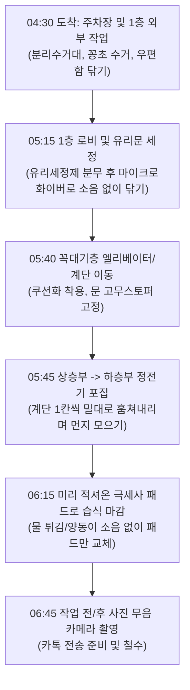

# 10. 평일 새벽 무소음 빌라 청소 가이드 & SOP

> **"경쟁 업체는 평일 새벽에도 어떻게 민원 없이 빌라 청소를 해내는가?"**
> 평일 새벽(04:30~07:00)에 소음 없이 빌라 청소를 할 수 있게 되면, 주말에만 갇혀 있던 작업 용량이 **평일 5일로 확장**되어 부수입 창출 속도와 고객 수용력이 2~3배로 뜁니다.

---

## 1. 경쟁업체 현장 관찰 분석: 평일 새벽 청소의 비밀

경쟁업체(전문 계단 청소 대행사, 베테랑 개인 사업자)들이 평일 이른 아침(05:00~07:30)에 빌라를 문제없이 청소하는 핵심 원리는 다음과 같습니다.

| 관찰 항목 | 일반인이 생각하는 방식 (소음 유발) | 베테랑 경쟁업체의 방식 (무소음) |
|---|---|---|
| **먼지 청소** | 진공청소기, 빗자루 탁탁 털기 | **정전기 부직포 밀대(양면) + 리스킹 오일 마포** (마찰 소음 제로) |
| **바닥 물청소** | 양동이에 걸레 퍽퍽 빨기, 짤순이 덜컹거림 | **사전 적심 극세사 패드 다량 준비(1동당 3~4장 교체식)** |
| **작업 동선** | 1층부터 위로 올라가며 소음 전파 | **옥상/최상층부터 조용히 내려오기** 또는 **외부 1층 먼저 진행** |
| **도구 이동** | 바퀴 달린 플라스틱 카트 드르륵 소리 | **무소음 우레탄 바퀴 카트** 또는 **숄더백/소프트 버킷 휴대** |
| **신발/발걸음** | 안전화 쿵쿵거림, 밑창 끄는 소리 | **소프트 EVA 폼 쿠션 슬리퍼(실내화) 착용** |
| **출입문 관리** | 자동문 센서 삑삑음, 도어락 걸쇠 쾅 | **도어스토퍼(고무 쐐기) 즉시 고정, 도어락 무음 설정** |

---

## 2. 무소음 5대 작업 원칙 (Silent 5 Rules)

### 원칙 1. "기계(진공청소기·기계탈수)는 새벽에 절대 켜지 않는다"
- 빌라는 콘크리트 계단실 특성상 **저주파 모터 진동음이 전 층으로 울려 퍼집니다.**
- 새벽 작업에서는 전기·배터리 구동 진공청소기를 배제하고, **대형 정전기 밀대**와 **극세사 플랫맙(Flat Mop)** 만 사용합니다.

### 원칙 2. "현장에서 물을 틀거나 걸레를 세탁하지 않는다" (프리셋 방식)
- 새벽에 수도를 세게 틀어 양동이에 물 받는 소리, 화장실/공용수도 개폐 소리는 아주 크게 들립니다.
- **해결책**: 집에서 미리 세정액(중성세제+린스 소량)에 적셔 탈수한 극세사 걸레 패드를 밀폐 지퍼백/보관통에 **5~8장 담아서 출발**합니다. 더러워진 패드는 교체하여 수거통에 넣고, 세탁은 퇴근 후 자택에서 일괄 진행합니다.

### 원칙 3. "신발과 도구함에 쿠션을 씌운다"
- 발뒤꿈치 충격을 흡수하는 **무소음 EVA 쿠션 실내화/작업화**를 착용합니다. (계단 오르내릴 때 '쿵쿵' 발망치 소리 원천 차단)
- 도구함/버킷 바닥에 **펠트 스티커나 실리콘 패드**를 붙여 대리석 바닥에 내려놓을 때 '탁' 소리가 나지 않도록 합니다.

### 원칙 4. "시간대별 안/밖 공간 분리"
- **04:30 ~ 05:30 (초새벽, 가장 깊은 수면 시간)**:
  - 외부 분리수거장 정리, 주차장 바닥 쓰레기 쓸기, 1층 로비 현관 유리창 닦기, 우편함 정돈. (실외·1층 작업)
- **05:30 ~ 07:00 (기상 준비 시간)**:
  - 실내 계단실 진입. 꼭대기 층(4~5층)으로 조용히 걸어 올라간 뒤, 부직포 밀대 및 극세사 패드로 소음 없이 훔치며 아래로 내려옵니다.

### 원칙 5. "방화문과 세대 현관문 충격 방지"
- 계단실 방화문이나 공동현관문이 바람에 '쾅' 닫히지 않도록 **고무 도어스토퍼(도어웨지)** 를 가방에 2개 지참하여 문을 고정해 두고 작업합니다.

---

## 3. 무소음 장비 세팅 리스트 (초기 예산 내 구성)

| 장비명 | 용도 및 규격 | 특징 | 예상 비용 |
|---|---|---|---|
| **정전기 청소 밀대 (대형 40~60cm)** | 계단/복도 머리카락·미세먼지 포집 | 바닥과 마찰음이 전혀 없음 | 25,000원 |
| **점착식 정전기 부직포 롤/포** | 일회용 또는 다회용 먼지 포집포 | 쓸지 않고 밀고 지나가면 끝 | 15,000원 |
| **극세사 플랫맙 (초경량 알루미늄봉)** | 계단 물걸레 청소 | 가볍고 벽면에 부딪혀도 소음 적음 | 30,000원 |
| **극세사 패드 (10장 세트)** | 1동당 2~3장씩 교체 사용 | 집에서 세정액에 적셔 지퍼백 보관 | 20,000원 |
| **무소음 우레탄 바퀴 접이식 카트** | 도구 이동 시 골목 소음 방지 | 플라스틱 바퀴 대신 고무/우레탄 필수 | 45,000원 |
| **무소음 EVA 소프트 슬리퍼/덧신** | 계단 보행 소음 방지 | 뒤꿈치 충격 흡수 3cm 이상 | 15,000원 |
| **고무 도어스토퍼 (2개)** | 현관문·방화문 고정용 | 문 쾅 닫힘 방지 | 5,000원 |
| **합계** | | | **약 155,000원** |

---

## 4. 무소음 계단 청소 표준 작업 절차 (SOP)

### 세부 행동 수칙
1. **카메라 촬영 시**: 스마트폰 기본 카메라의 '찰칵' 소리가 새벽 복도에서 크게 울리므로, **무음 카메라 앱**을 사용합니다.
2. **먼지 처리**: 빗자루로 바닥을 탁탁 치지 말고, 계단 모서리에 모인 먼지 뭉치는 물티슈나 소형 헝겊으로 한 번에 집어서 비닐봉지에 담습니다.
3. **난간 및 창틀**: 극세사 손걸레로 한 방향으로 부드럽게 훔쳐내며, 걸레를 공중에서 털지 않습니다.
4. **주민 조우 시 대응**:
   - 새벽 5시~6시대에 출근하거나 운동 나가는 주민을 마주치면, 먼저 벽 쪽으로 비켜서서 **목소리를 낮추어 가볍게 목례("안녕하십니까")** 합니다.
   - 단정하고 깨끗한 복장(유니폼 조끼 착용)을 갖추고 있으면, 주민은 불쾌해하기보다 "새벽부터 건물을 깨끗하게 관리해 주는구나"라는 신뢰감을 갖게 됩니다.

---

## 5. 평일 새벽 청소가 가능해졌을 때의 사업적 효과

### 1) 주말 병목 해소 & 고객 수용 능력 2배 증가
- 주말만 청소할 경우: 최대 **8동**이 물리적 한계.
- **평일 새벽 3일(월·수·금) 추가 가동 시**:
  - 새벽 1일당 1~2동 청소 가능 (05:00~06:30 사이 1~2동)
  - 주 3일 새벽 = 주 4~5동 추가 소화 가능!
  - **총 수용량: 주말 8동 + 평일 새벽 4~6동 = 총 12~14동 관리 가능**

### 2) 수익성 도약 (사이드잡 단계)
- 빌라 12동 관리 시: 월 매출 약 **264만 원** (22만 원 × 12동)
- 재료비/경비 약 30만 원 제외 시 **월 순수익 약 234만 원 달성**
- 본업 세전 240만 원(실수령 약 214만 원)과 합치면 **월 총 실수령액이 440만 원을 초과**하여 대표님의 목표(추가 100만 원 이상)를 2배 이상 초과 달성하게 됩니다.

---

## 6. 임대인·관리단 영업 시 '새벽 무소음' 셀링 포인트

영업 제안 시 오히려 이를 강력한 차별점으로 활용합니다:

> **"저희는 입주민분들의 출근길(오전 7시 이전)에 계단과 로비가 호텔처럼 반짝이도록 청소를 끝마칩니다.**
> **소음 민원이 없도록 모터 청소기를 쓰지 않고, 정전기 포집 방식과 무소음 전용 패드로 소리 없이 완벽하게 관리합니다."**

- 임대인 입장에서는 낮 시간에 청소 아주머니가 호스 끌고 다니며 계단을 적셔놓아 미끄럼 사고 위험이 생기는 것보다, **출근 전에 뽀송뽀송하게 청소가 끝나 있는 상태**를 훨씬 선호합니다.
